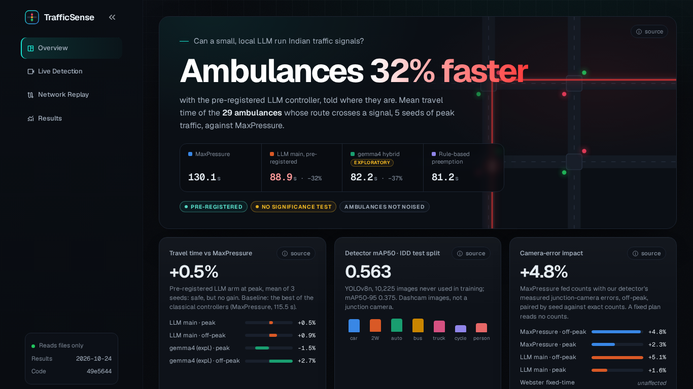
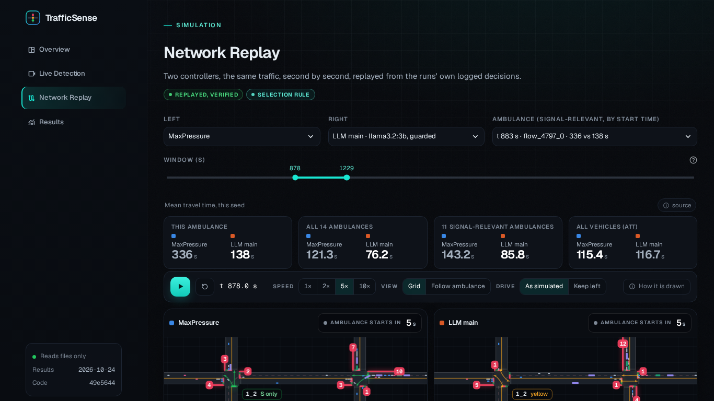
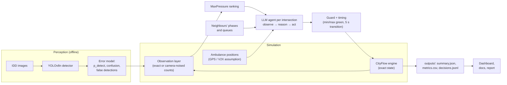

<div align="center">

# TrafficSense

**AI-assisted traffic signals for Indian roads, tested in simulation**

<!-- BEGIN:readme_badges -->


<!-- END:readme_badges -->

</div>

<a id="in-one-minute"></a>

## ⏱️ In one minute

**The problem.** Traffic lights in Indian cities often run on fixed timers, so they cannot react to
the traffic actually waiting, or to an ambulance stuck in a queue.

**What we built.** A computer [simulation](#g-simulation) of city junctions with Indian-style traffic, in which
each traffic light is run by a small AI language model ([LLM](#g-llm)) on an ordinary laptop, plus a
camera-based vehicle detector ([YOLO](#g-yolo)) trained on photos of Indian roads.

**The main result.** In a test planned in advance ([pre-registered](#g-prereg)), the AI-run lights moved traffic
about as well as the best standard method: average trip times within
0.5<!--=f.peak.llm.vs_mp-->–0.9<!--=f.off.llm.vs_mp-->%, but not better. When told about approaching ambulances, they got
them through 31.7<!--=e.llm.amb_cut_vs_mp-->% faster (130.1<!--=e.mp.amb--> s → 88.9<!--=e.llm.amb--> s on average).

**Why it matters.** A small, local AI is not yet a better traffic controller, but it is a safe
add-on that can use information plain rules ignore, such as an emergency vehicle.

Traffic-signal control for a simulated Indian-style road network, comparing classical
controllers with **cooperative LLM agents** that run on a local 3–4 B model (adapted from
CoLLMLight, ICLR 2026). It also includes a **YOLOv8n vehicle detector** trained on the India Driving
Dataset, whose measured errors are fed back into the simulation, and a **Streamlit dashboard**
that only reads the result files. B.Tech capstone project. Every number on this page is
checked against `outputs/` by `python scripts/make_report.py --check`.

<a id="tech-stack"></a>

## 🧰 Tech stack

| Part | What we used |
|---|---|
| Simulation | [CityFlow](#g-cityflow) traffic simulator, Python 3.10 |
| AI agents | small [LLMs](#g-llm) run locally with [Ollama](#g-ollama) (`llama3.2:3b` is the pre-registered model) |
| Vision | Ultralytics YOLOv8n trained on the India Driving Dataset ([IDD](#g-idd)) |
| Dashboard | Streamlit and Plotly |
| Report | pandoc and LaTeX (Tectonic), figures with matplotlib |

<a id="contents"></a>

## 🧭 Contents

- [In one minute](#in-one-minute) · [Tech stack](#tech-stack)
- [🚦 Headline findings](#headline-findings)
- [📊 Dashboard](#dashboard)
- [🏗️ Architecture](#architecture)
- [⚡ Quick start](#quick-start)
- [🔁 Reproducing the results](#reproducing-the-results)
- [📁 Repository layout](#repository-layout)
- [⚠️ Limitations](#limitations)
- [🙏 Credits and licences](#credits-and-licences)
- [📖 Glossary](#glossary)

<a id="headline-findings"></a>

## 🚦 Headline findings

> 💡 **In plain words:** We timed every simulated vehicle trip from start to finish. The [average travel time](#g-att) (ATT)
> is the main score, and lower is better. In the table, each column is one way of running the traffic
> lights and each row is one test situation. The AI-run lights (third column) end up within
> 0.9<!--=f.off.llm.vs_mp-->% of the best standard method, [MaxPressure](#g-maxpressure), and get ambulances through
> 31.7<!--=e.llm.amb_cut_vs_mp-->% faster.


The LLM design, its selection rule and the full-experiment plan were committed before any of
those runs (pre-registration, [`docs/llm_benchmark.md`](docs/llm_benchmark.md),
[`docs/results.md`](docs/results.md)). The pre-registered controller is **`llm_guarded_mp`
with `llama3.2:3b`**: MaxPressure proposes its top two phases, the LLM picks one of them or
keeps the current phase, and a guard applies the LLM's pick only if its pressure is within
20%<!--=cfg.guard.margin--> of the best phase's. Mean ± std over seeds, 3600<!--=cfg.steps--> s per run; ATT = average travel time.

<!-- BEGIN:readme_headline -->
|  | MaxPressure | Webster fixed time | **LLM, pre-registered** (guarded, `llama3.2:3b`) | LLM, exploratory (`gemma4:e4b`) |
|---|--:|--:|--:|--:|
| ATT (s), Indian 2x2, off-peak (3 seeds) | 88.1 ± 1.0 | 100.4 ± 4.1 | 89.0 ± 0.8 (+0.9%) | 90.5 ± 1.2 (+2.7%) |
| ATT (s), Indian 2x2, peak (3 seeds) | 115.5 ± 0.9 | 116.3 ± 4.6 | 116.1 ± 2.9 (+0.5%) | 113.7 ± 0.3 (−1.5%) |
| ATT (s), Jinan 3x4, real flow (3 seeds) | 300.9 ± 0.0 | 416.1 ± 0.0 | 303.2 ± 1.1 (+0.8%) | not run |
| Ambulance travel time (s), mean of 29 signal-relevant trips, 5 seeds | 130.1 | 123.5 | 88.9 (preemption rule: 81.2) | 82.2 |
| ATT change with junction-camera counts (off-peak / peak) | +4.8% / +2.3% | unaffected (reads no counts) | +5.1% / +1.6% | not run |
<!-- END:readme_headline -->

1. **The pre-registered LLM controller matches MaxPressure but does not beat it.** Its ATT is
   +0.9%<!--=f.off.llm.vs_mp--> off-peak, +0.5%<!--=f.peak.llm.vs_mp--> at peak and +0.8%<!--=f.jinan.llm.vs_mp-->
   on the real Jinan flow, relative to MaxPressure. The small model's own answer differs from
   MaxPressure's choice in 91.5%<!--=l.off.llm.differs--> of off-peak calls, mostly by keeping
   the current phase. The guard overrides 81.2%<!--=l.off.llm.guard--> of the calls, so the
   phase actually applied differs from MaxPressure's in only 10.4%<!--=l.off.llm.applied-->.
   In this design the guard makes the LLM safe, not useful.
2. **Where the LLM clearly helps is ambulances.** Each ambulance near a signal is listed in
   the prompt. Mean travel time of the 29<!--=e.mp.amb_n--> signal-relevant ambulances (5
   seeds): MaxPressure 130.1<!--=e.mp.amb--> s, the pre-registered LLM arm 88.9<!--=e.llm.amb--> s
   (31.7%<!--=e.llm.amb_cut_vs_mp--> faster), and a hand-written preemption rule 81.2<!--=e.pre.amb--> s.
   Normal traffic does not pay for it: ATT 116.4<!--=e.llm.att--> s vs MaxPressure's
   115.7<!--=e.mp.att--> s.
3. **Realistic camera errors cost every count-based controller a few percent.** The
   simulator stays exact; only the controllers' counts are noised, using the error rates our own
   detector makes. With junction-camera counts, MaxPressure loses +4.8%<!--=c.off.mp.junction.pct-->
   off-peak and +2.3%<!--=c.peak.mp.junction.pct--> at peak, and the LLM arm about as much. A
   Webster fixed-time plan reads no counts and is unaffected. At peak this erases adaptive
   control's small lead over Webster. A post-hoc decomposition attributes most of the off-peak
   loss to false detections ([`docs/camera_error.md`](docs/camera_error.md)).
4. **The detector** (YOLOv8n, 640<!--=cfg.imgsz--> px, trained for 13.3<!--=d.train_h--> h on a GTX 1650)
   reaches mAP50 0.563<!--=d.test.map50--> and mAP50-95 0.375<!--=d.test.map5095--> on held-out
   IDD drives. Most of its errors are distant objects: it misses
   59<!--=d.size.motorcycle.small-->–76<!--=d.size.person.small-->% of small boxes (59.0<!--=d.size.motorcycle.small-->% for motorcycles,
   75.7<!--=d.size.person.small-->% for pedestrians) but only
   1.3<!--=d.size.car.large-->% of large cars ([`docs/perception.md`](docs/perception.md)).
5. **The simulator was validated** against the CoLLMLight authors' own code. Driven the same way,
   it reproduces their FixedTime and MaxPressure throughput and queue exactly on all three of their
   datasets, and their waiting and travel times to within CityFlow's own run-to-run noise
   (with lane changing on, as their settings need, CityFlow is not exactly repeatable). Along the way we found that **CoLLMLight's
   FixedTime baseline never gives north–south traffic a green**
   ([`docs/validation.md`](docs/validation.md)).

**Exploratory, not selected by the rule** (added after the plan, reported separately):
`gemma4:e4b` in the unguarded hybrid follows pressure far more often and has a lower ATT than
MaxPressure at peak on all 3 seeds (−1.5%<!--=f.peak.gem.vs_mp-->). Off-peak it is
worse (+2.7%<!--=f.off.gem.vs_mp-->). It needs 4.54<!--=l.peak.gem.lat--> s per call on this
GPU, so it is not real-time. A model-size study ([`docs/model_size.md`](docs/model_size.md))
finds that with 3 B models the same hybrid is far worse than MaxPressure (ATT
+51.0%<!--=m.peak.qwen.vs_mp--> and +81.4%<!--=m.peak.llama3b.vs_mp--> at peak). From
`gemma4:e4b` up to a hosted 550<!--=m.size.nemo--> B model, ATT stays within seed noise of MaxPressure.

<a id="dashboard"></a>

## 📊 Dashboard

> 💡 **In plain words:** The dashboard is a small website that shows the results as pictures you can click through,
> including a side-by-side replay of two ways of running the same junctions, so you can watch an
> ambulance get stuck or get through. It only shows numbers that are saved in the result files.


`streamlit run src/trafficsense/dashboard/app.py`: four pages (Overview, Live Detection, Network
Replay, Results). Every number on them is read from `outputs/` at run time, with a source chip
naming the file ([`docs/dashboard.md`](docs/dashboard.md)).

| Overview | Network Replay (MaxPressure vs the LLM arm, one ambulance's trip) |
|:--:|:--:|
|  |  |

<a id="architecture"></a>

## 🏗️ Architecture

> 💡 **In plain words:** Think of each junction as having its own assistant. A camera counts the vehicles waiting (here the
> counts come from the simulator, optionally with the mistakes our real detector makes). A standard
> rule, [MaxPressure](#g-maxpressure), suggests the best options; the AI [agent](#g-agent) picks one and says why in a
> short sentence; a safety check (the [guard](#g-guard)) makes sure the choice is reasonable; then the light
> changes. The loop repeats every 5<!--=cfg.mp.interval--> seconds at every junction.




Each intersection is one agent. Every 5 s, once its minimum green is met, it receives its
own queues and pressures, its neighbours' phases and queues towards it, and any ambulance
within 150<!--=cfg.amb.range--> m. It answers in JSON (Ollama `/api/chat` with a JSON schema). Signal timing (the
transition phase, minimum and maximum green) is enforced outside the LLM. A failed call is
counted and falls back to MaxPressure's choice, never silently.

<a id="quick-start"></a>

## ⚡ Quick start

> 💡 **In plain words:** This section is for people who want to run the project on their own computer. You need a
> Windows PC with [WSL](#g-wsl) (Linux inside Windows), a graphics card for the AI parts, and some comfort
> with typing commands. You do not need any of this to read the results.


Tested on WSL2 Ubuntu 22.04 with Python 3.10 (CityFlow does not build on Python 3.13), on
a GTX 1650 (4 GB) with 16 GB RAM. The LLM and the detector cannot share this GPU, so do not
run them at the same time.

```bash
sudo apt install -y python3.10-venv build-essential cmake git
git clone https://github.com/Pilli9375/trafficsense.git && cd trafficsense
python3.10 -m venv .venv && source .venv/bin/activate
pip install -U pip

# CityFlow, built from source
git clone https://github.com/cityflow-project/CityFlow.git ../CityFlow
pip install ../CityFlow

# This package (add ",perception" for YOLO training and evaluation)
pip install -e ".[dev,dashboard]"
pytest -q

# CoLLMLight's roadnets and flows (Jinan, Hangzhou, Synthetic) into data/external/ (gitignored)
scripts/fetch_collmlight_data.sh

# One baseline run: Indian 2x2 at peak demand, MaxPressure, seed 0 (about a minute)
python scripts/run_experiment.py --scenario indian_2x2_peak --controller maxpressure --seed 0
```

The LLM needs [Ollama](https://ollama.com) on `http://localhost:11434`:

```bash
curl -fsSL https://ollama.com/install.sh | sh
ollama pull llama3.2:3b             # the pre-registered model
ollama pull gemma4:e4b              # exploratory arm only
# A 600 s run of the pre-registered controller (needs a clean git tree and an idle GPU)
python scripts/benchmark_llm.py --arm guarded_v3 --models llama3.2:3b
```

Each run writes `outputs/runs/<time>_<scenario>_<controller>_s<seed>/` with `summary.json`
(metrics plus provenance: controller, model as reported by the server, seed, scenario, git
commit, LLM calls, failures and latency) and `metrics.csv`.

<a id="reproducing-the-results"></a>

## 🔁 Reproducing the results

> 💡 **In plain words:** Every number in this project can be recreated from scratch with the commands below, and every
> results document has an automatic check that fails if its numbers and the saved data ever
> disagree. The full set of experiments took more than a day of computer time, so most readers will
> only want to look, not rerun.


Each step writes to `outputs/` and has a doc whose tables are generated from those files; every
`make_*` / report script has a `--check` that fails if its doc and the data disagree. The batch
scripts are resumable and skip finished runs. Times are for the hardware above.

<details>
<summary><b>Show all steps and the check commands</b> (a table of every script, plus one command that re-checks everything)</summary>

| Step | Command | Doc |
|---|---|---|
| Simulator validation against CoLLMLight's code | `scripts/validation/*.py`, then `python scripts/validation/make_tables.py` | [`validation.md`](docs/validation.md) |
| Indian 2x2 scenario: roadnet, demand calibration, flows | `python scripts/generate_indian_roadnet.py`, `calibrate_indian_demand.py`, `generate_indian_flow.py --level all --seed 0 1 2` | [`indian_scenario.md`](docs/indian_scenario.md) |
| Baseline tuning (pre-registered sweeps) | `python scripts/tune_maxpressure.py`, `tune_maxpressure_min_green.py`, `run_indian_experiments.py` | [`baselines.md`](docs/baselines.md) |
| LLM benchmark and final design round | `python scripts/benchmark_llm.py --arm <arm>` | [`llm_benchmark.md`](docs/llm_benchmark.md) |
| Full experiments (67<!--=f.runs--> runs of 3600<!--=cfg.steps--> s) | `python scripts/run_full_experiments.py`, then `make_results.py` | [`results.md`](docs/results.md), [`emergency.md`](docs/emergency.md) |
| Detector on IDD | `python scripts/prepare_idd.py`, `train_detector.py --full`, `eval_detector.py --stage val`, then `--stage test` | [`perception.md`](docs/perception.md) |
| Camera-error experiment (130<!--=c.runs--> runs) | `python scripts/run_camera_error.py`, `run_camera_decomposition.py`, `make_camera_error.py` | [`camera_error.md`](docs/camera_error.md) |
| Model size (exploratory) | `python scripts/run_model_size.py --bench`, then `--full`, then `make_model_size.py` | [`model_size.md`](docs/model_size.md) |
| Dashboard data | `python scripts/make_replays.py`, `make_sample_clip.py` | [`dashboard.md`](docs/dashboard.md) |
| README and report | `python scripts/make_report.py`, `build_report.py` | [`docs/report/`](docs/report/) |

To check everything at once:

```bash
pytest -q
for s in validation/make_tables make_indian_tables make_baseline_tables make_results \
         make_camera_error make_model_size make_perception_results make_report; do
  python scripts/$s.py --check || echo "FAILED: $s"
done
python scripts/benchmark_llm.py --check
python scripts/run_emergency_smoke.py --check
python scripts/make_replays.py --check
```

</details>

Large files live outside git: IDD and its resized copy, detector runs and weights, replays and
the sample clip, all reached through gitignored symlinks under `data/external/` whose targets
are set in `configs/default.yaml`.

<a id="repository-layout"></a>

## 📁 Repository layout

> 💡 **In plain words:** A map of the project's folders: where the settings, the code, the experiments, the results and the
> documents live.


<details>
<summary><b>Show the folder tree</b></summary>

```text
configs/               default.yaml (all settings and paths), scenarios/indian_2x2.yaml
data/scenarios/        the generated Indian 2x2 roadnet and flow files (in git)
data/external/         CoLLMLight data, IDD, detector runs, replays (gitignored, symlinks)
src/trafficsense/
  sim/                 roadnet parsing, env wrapper with signal timing, metrics, demand,
                       capacity, ambulances, camera-noise observation layer, replay
  control/             fixedtime, webster, maxpressure, preemption, llm, guided (hybrid/guarded)
  llm/                 Ollama and hosted clients, prompts v1-v3, response schema, GPU probe
  perception/          IDD conversion, detector training/evaluation, error model
  report/              facts, number checking, tables and figures for README and report
  dashboard/           Streamlit app (reads outputs/ only)
scripts/               every experiment, table and figure (each with --check where it writes a doc)
tests/                 pytest (simulator, controllers, LLM client with injected fakes, dashboard, ...)
outputs/               one folder per run (summary.json, metrics.csv, decisions.jsonl) and the
                       aggregated results.json of each study; _invalid_legacy/ = old, invalid results
docs/                  one document per study, screenshots, and the project report (docs/report/)
```

</details>

<a id="limitations"></a>

## ⚠️ Limitations

> 💡 **In plain words:** What this project does *not* show. Everything happened in a computer [simulation](#g-simulation), the
> simulated drivers keep to their lanes (real Indian traffic often does not), and each test was
> repeated only a few times (see [seed](#g-seed)), so very small differences may be luck.


* **CityFlow is lane-based.** It cannot represent lane-free driving, two-wheelers filtering
  between cars, or vehicle width. The Indian 2x2 network has an Indian vehicle mix and sizes and
  is mirrored for left-hand traffic, but it is "a lane-based simulation with an Indian vehicle
  mix", not Indian traffic ([`docs/indian_scenario.md`](docs/indian_scenario.md)).
* **Demand is synthetic** (Poisson arrivals, assumed turn shares), calibrated against measured
  capacity rather than counts from a real junction. Only Jinan uses a real-world flow.
* **Few seeds.** 3 seeds per scenario (5 with ambulances) and no significance test was
  pre-registered. Differences of a percent or two are within seed-to-seed noise.
* **The LLM arms are slow on a 4 GB GPU.** The pre-registered arm needs about a second per call;
  the better-performing `gemma4:e4b` needs 4–5 s and is not real-time. The simulation waits
  during calls.
* **LLM runs are not bit-for-bit repeatable.** Ollama on a GPU is not deterministic at
  temperature 0. Every decision is logged and can be replayed.
* **The camera study uses a proxy.** IDD is filmed from a moving vehicle, not from a pole at a
  junction. Ambulance positions are assumed to come from GPS / V2X and are never noised.
* **Ambulances cannot overtake or make others yield** in CityFlow. Only the signal can help them.
* No field test, no real junction camera footage, and no pedestrians in the simulation.

<a id="credits-and-licences"></a>

## 🙏 Credits and licences

> 💡 **In plain words:** Who made the tools and data we used, and the rules for using them. The Indian street photos used to
> train the detector are not included here; anyone who wants them must get them from the original
> authors.


* **CoLLMLight**: Yuan, Lai and Liu, *CoLLMLight: Cooperative Large Language Model Agents for
  Network-Wide Traffic Signal Control*, ICLR 2026
  ([code](https://github.com/usail-hkust/CoLLMLight)). Their roadnets and flows are downloaded
  by `scripts/fetch_collmlight_data.sh` and not stored in this repo. Their code is run unmodified
  for validation only (it is not copied here). Their repository has no licence file
  (checked at commit `ce204a9`).
* **CityFlow** ([cityflow-project/CityFlow](https://github.com/cityflow-project/CityFlow),
  Apache-2.0): the simulator. Its grid generator is vendored in `src/trafficsense/sim/_vendor/` with
  its licence.
* **IDD, the India Driving Dataset** (IIIT Hyderabad and Intel,
  [idd.insaan.iiit.ac.in](https://idd.insaan.iiit.ac.in)): downloaded after registration and used
  under its terms of use. **The dataset is not redistributed here**: no images or labels are in
  this repository, only conversion scripts, statistics and our model's error measurements.
  Trained weights are kept outside git.
* **Ultralytics YOLOv8** (AGPL-3.0) for detection; **Ollama** for local inference; the models
  `llama3.2:3b` and `llama3.1:8b` (Llama Community License), `gemma4:e4b` (Gemma terms),
  `qwen2.5:3b` (Qwen licence) are used under their own licences and not redistributed.
  Nemotron 3 Ultra was called through NVIDIA's hosted API (exploratory study only).
* **Geist and Geist Mono** fonts (SIL Open Font License 1.1), bundled in
  `src/trafficsense/dashboard/static/fonts/` with the licence text.
* Vehicle mix and dimensions: Arasan et al. (2008) via the iTrans/IIT Delhi report for
  ICCT and ITDP (2009); Umapathi and Khatawkar (2019). Full references in
  [`docs/indian_scenario.md`](docs/indian_scenario.md) and the report.

The project report (Markdown chapters, Word and PDF build) is in [`docs/report/`](docs/report/).

<a id="glossary"></a>

## 📖 Glossary

<details open>
<summary><b>Glossary</b>: every technical term on this page in one plain sentence (click to fold)</summary>

- <a id="g-phase"></a>**Traffic signal phase**: one combination of green lights at a junction, for example "north and south may go straight"; changing phase costs a few seconds of yellow and red.
- <a id="g-att"></a>**ATT (average travel time)**: how long a vehicle takes, on average, from the moment it is due to start its trip until it arrives, including any time spent waiting to enter the roads.
- <a id="g-maxpressure"></a>**MaxPressure**: a standard rule that gives green to the direction with the most waiting vehicles compared with the queue just after the junction; it needs no training.
- <a id="g-pressure"></a>**Pressure**: vehicles waiting that a green would let through, minus vehicles already queued on the roads they would drive into.
- <a id="g-fixedtime"></a>**Fixed-time and Webster**: fixed-time lights repeat the same timer plan; Webster's method is the classic formula for choosing good timings for such a plan from traffic counts.
- <a id="g-preemption"></a>**Preemption**: a rule that turns a light green for an approaching emergency vehicle.
- <a id="g-llm"></a>**LLM (large language model)**: an AI that reads and writes text, like a chatbot; here a small one decides which light should be green and explains why.
- <a id="g-ollama"></a>**Ollama**: free software that runs LLMs on your own computer instead of in the cloud.
- <a id="g-agent"></a>**Agent, multi-agent**: an agent is a program that observes, decides and acts on its own; multi-agent means several of them (one per junction) working side by side and sharing information.
- <a id="g-guard"></a>**Guard**: a safety check that lets the AI's choice through only if it is close to the best standard choice.
- <a id="g-prereg"></a>**Pre-registered**: the test plan and the rule for judging it were written down and saved before the experiment ran, so results could not be picked after the fact.
- <a id="g-exploratory"></a>**Exploratory**: an extra test added after the plan was fixed; interesting, but weaker evidence.
- <a id="g-seed"></a>**Seed**: a number that fixes the random traffic of one test run; different seeds give different but comparable traffic, and repeating a test with several seeds shows how much results vary.
- <a id="g-std"></a>**Mean ± std**: the average of the repeated runs and how much they vary (the standard deviation).
- <a id="g-simulation"></a>**Simulation**: a computer model in which virtual vehicles drive on virtual roads, so ideas can be tested without touching real traffic.
- <a id="g-cityflow"></a>**CityFlow**: the traffic simulator used here, common in traffic-light research.
- <a id="g-yolo"></a>**YOLO, YOLOv8n**: a fast family of AI models that find and label objects (cars, buses, people) in images; "n" is the smallest version.
- <a id="g-map"></a>**mAP50**: a score from 0 to 1 for how well a detector finds and labels objects, where 1 is perfect; a detection counts if its box overlaps the real object by at least half.
- <a id="g-idd"></a>**IDD (India Driving Dataset)**: photos taken from vehicles on Indian roads, with every road user marked.
- <a id="g-collmlight"></a>**CoLLMLight**: the research paper and code this project builds on, in which one LLM agent runs each traffic light.
- <a id="g-gpu"></a>**GPU**: the graphics card; it runs AI models much faster than the main processor.
- <a id="g-wsl"></a>**WSL**: Windows Subsystem for Linux, a way to run Linux programs inside Windows.

</details>

---

<div align="center">

Built as a B.Tech capstone project.<br>
{{AUTHORS}} · Guide: {{GUIDE}} · {{UNIVERSITY}}<br>
Full project report: [docs/report/](docs/report/)

</div>
