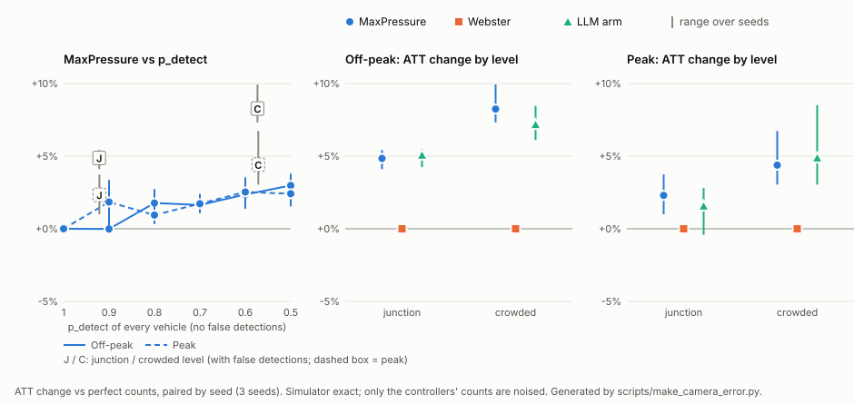

# Camera-error experiment: how much do realistic detector errors hurt each controller?

Phase 4c. Sections 1–6 are the design, committed **before any run** (pre-registration).
Results are added below them afterwards, generated from the run files by
`scripts/make_camera_error.py` (`--check` verifies them).

## 1. Question and idea

Every earlier experiment gave the controllers exact vehicle counts read from the simulator.
A real junction would count vehicles with a camera and a detector, which misses some
vehicles, invents some, and mislabels some. Here the controllers see counts with the
errors our own detector makes (docs/perception.md section 8, `outputs/perception/error_model.json`),
while **the simulator itself stays exact**: vehicles move as before, and every metric is
still measured from the engine. Only what the controllers *observe* changes.

## 2. Observation-noise layer (`src/trafficsense/sim/observation.py`)

Controllers read lane counts only through `TrafficEnv.lane_view()` (MaxPressure's pressures
via `get_state`, the LLM prompt via `prompt.observe`). At level `perfect` this returns the
engine's own counts, exactly as before; a test checks that a noisy level with p_detect = 1
and no false detections gives identical counts and an identical run.

At a noisy level there is **one camera per road** (a road is an approach of the intersection
it leads to). Whenever a controller observes at a simulator step, a fresh snapshot is drawn
for the whole network and cached for that step, so all intersections deciding at the same
second see the same snapshot. The next observation draws again: no vehicle stays "blind".

For each vehicle on a lane:

1. it is **detected** with probability `p_detect[class]`;
2. a detected vehicle gets a **label** drawn from the measured label probabilities
   `P(label | true class, detected)` (the normalised rows of the confusion matrix). It is
   counted as a vehicle only if the label is a vehicle class (car, motorcycle,
   autorickshaw, bus, truck, bicycle). A vehicle labelled `person` is lost from the count;
3. it counts as **stopped** (queue) if its speed is below 0.1 m/s, CityFlow's own waiting
   definition.

Then, per road and per vehicle class j, a **Poisson(false_det[j])** number of phantom
vehicles is added, each on a uniformly chosen lane of the road and counted as stopped.
ASSUMPTION: false positives of a fixed camera are mostly static clutter (parked vehicles,
structures), and a stopped phantom is the case that changes queue-based decisions most. The
rate is the measured false detections per image, read as per camera frame.

Draws come from a numpy `Generator` seeded with `SeedSequence([run seed, crc32(level)])`.
Each run's `summary.json` (`observation`) records the level, every parameter, the source
file and its sha256, the seed, the number of snapshots and the **realised** detection rate
per class and false detections per road and snapshot. `noise.jsonl` logs every snapshot
(true vehicles, detected, lost to a non-vehicle label, phantoms added, per class).

### 2.1 Vehicle types → detector classes

| simulator type (configs/scenarios/indian_2x2.yaml) | detector class |
|---|---|
| motorcycle | motorcycle |
| auto_rickshaw | autorickshaw |
| car | car |
| bus | bus |
| truck | truck |
| ambulance | **not noised** (see 2.2) |

The simulator has no bicycles and no pedestrians. Detector labels `bicycle` (from
confusion or false detections) are counted as vehicles; `person` is not.

### 2.2 Ambulances are not noised

IDD has no ambulance class, so we have no measured error for ambulances. **Ambulance
positions are assumed to come from a separate channel (GPS / V2X) and are never noised:**
`preemption_mp` and the LLM arm's ambulance list read them from the engine as before
(`sim/emergency.py`), and an ambulance in a queue is counted exactly. This is stated with
every emergency result.

### 2.3 What the class confusion can and cannot affect

MaxPressure, preemption and the guarded LLM arm all decide from **class-free counts**
(pressure = stopped vehicles in − stopped vehicles out). The main arm's prompt
(`guided_v3`) shows pressure and queue only, **no vehicle-type counts**. So label confusion
matters here only through vehicles lost to the `person` label; the type mix it produces is
computed (`LaneView.type_counts`, used by the v1/v2 prompts) but no controller in this
experiment reads it. We state this rather than claim an effect of confusion.

## 3. Noise levels

| level | p_detect per class | labels | false detections |
|---|---|---|---|
| `perfect` | exact counts (no noise layer) | exact | none |
| `junction` ("junction camera") | measured on **medium + large** test objects, pooled over their ground truth: queued vehicles near the stop line are close to the camera | measured | measured, all sizes |
| `crowded` ("crowded / far") | measured on **all** test objects | measured | measured |
| `uniform_pX` (sweep) | X for every class, X = 1.0, 0.9, 0.8, 0.7, 0.6, 0.5 | exact | none |

For information, the values `noise_params()` computes from `error_model.json`
(sha256 of the file is recorded in every run):

| class | junction p_detect | crowded p_detect | false det. per road and snapshot |
|---|---:|---:|---:|
| car | 0.936 | 0.568 | 0.222 |
| motorcycle | 0.913 | 0.567 | 0.271 |
| autorickshaw | 0.944 | 0.598 | 0.070 |
| bus | 0.907 | 0.632 | 0.039 |
| truck | 0.832 | 0.537 | 0.079 |
| bicycle | (not in the simulator) | | 0.006 |

False detections use the overall rate at both levels; we did not split them by size.
Caveat from perception.md: IDD is filmed from a moving vehicle, so these are a measured
proxy for an intersection camera, not its true error.

## 4. Runs (3,600 s each; `scripts/run_camera_error.py`, 130 runs)

| block | scenarios, seeds | levels | controllers |
|---|---|---|---|
| main | indian_2x2_offpeak, indian_2x2_peak; seeds 0–2 | perfect, junction, crowded | maxpressure, fixedtime_webster, main LLM arm |
| sweep | same | uniform p 1.0 … 0.5 | maxpressure |
| emergency | indian_2x2_peak_amb; seeds 0–4 | perfect (reference), junction | maxpressure, fixedtime_webster, preemption_mp, main LLM arm |

- **Main LLM arm:** `llm_guarded_mp` with llama3.2:3b on the local GPU, 5 s decisions, min
  green 15 s, LLM seed = run seed: the main arm of the full experiments.
- **preemption_mp** runs on the emergency scenario only: without ambulances it is
  MaxPressure by construction.
- **fixedtime_webster** plans its timings offline from the flow file and never reads
  counts at run time, so it should be unaffected. This is checked, not assumed: its
  runs must be identical at every level, with 0 snapshots drawn.
- **perfect is re-run** with this code for every controller, so each noisy run has a paired
  perfect run from the same commit (same scenario, seed and flow file).
- Estimated time: ~6.4 h (LLM runs ~770 s each, measured in the full experiments).

*Execution note, added after the design commit (`91aa214`) and before any result was looked
at:* the first start of the batch hung after 11 runs, at the start of run 12 (Webster,
off-peak, seed 1, crowded). The main thread and a newly created thread that had used no CPU
both waited on a futex, which points to CityFlow's worker-thread start-up. Each run now
executes in its own process with a timeout (5 / 10 / 60 min for MaxPressure / Webster /
LLM runs) and is killed and retried, at most twice, if it hangs
(`trafficsense.experiment.run_experiment_isolated`). Every hang is logged in
`outputs/camera_error/batch.log`. One completed run of that first start (MaxPressure,
off-peak, seed 1, crowded, 06:33) was recorded as `git_dirty` because analysis scripts
written meanwhile were not committed yet; the batch ignores dirty runs and makes it again.
The runs and the analysis are unchanged.

## 5. Analysis (fixed now)

- **Primary:** per scenario and controller, ATT at each level, mean ± std over seeds, and
  the **paired** change against perfect (same seed): mean and range over seeds, in seconds
  and in %.
- **Secondary:** queue per intersection, waiting time per vehicle, throughput, at each
  level.
- **Sweep:** MaxPressure ATT against p_detect, per scenario (mean ± std over seeds), with
  the junction and crowded levels marked at their mean p_detect.
- **Emergency:** ATT and the travel time of signal-relevant ambulances, perfect vs
  junction, per controller, paired by ambulance.
- **LLM arm:** call failures per level (should stay 0), guard override rate per level,
  disagreement with MaxPressure, descriptive only.
- **Checks reported with the results:** (a) `uniform_p1.00` MaxPressure runs identical to
  the perfect runs; (b) Webster identical across levels with 0 snapshots; (c) the
  deterministic perfect runs reproduce the full-experiment runs (outputs/full,
  outputs/emergency) exactly; (d) realised detection rates within ±0.01 of the targets.
- With 3 (or 5) seeds no significance test is claimed; differences are shown with their
  per-seed range.
- One chart: MaxPressure ATT vs p_detect (sweep), plus each controller at the three
  levels.

## 6. What this experiment does not cover

Tracking over time (a real counter could smooth detections across frames; here each
snapshot is independent), errors in ambulance detection, camera placement, occlusion
between lanes, and night or rain. The size split is the only distance proxy.

## 7. Results

*Added after all 130 runs. Tables and chart generated by `scripts/make_camera_error.py`
(`--check` verifies them against the runs; summary in `outputs/camera_error/results.json`).
The batch finished on 2026-10-24 (06:41–12:43 after the restart, 6.0 h); no run hit its
timeout. Reminders that apply to every number below: the simulator is exact and only the
controllers' counts are noised; ambulance positions are never noised (GPS / V2X assumption,
2.2); 3 seeds (5 on the emergency scenario), so differences are shown with their per-seed
range and no significance test is claimed.*

One clarification of section 2, from the code (`NoisyObserver`): "one camera per road" means
every road of the network, 24 in all: the 16 roads that enter an intersection and the 8 exit
roads at the boundary. The exit roads' counts are the downstream (outgoing) queues in
MaxPressure's pressure, so a phantom on an exit road lowers a movement's pressure.

*Paired ATT change against perfect counts, in %: mean over seeds, whiskers the range over
seeds. Ambulance positions are not noised (GPS / V2X assumption).*

### 7.1 Camera parameters used

<!-- BEGIN:camera_params -->
| detector class | junction p_detect | crowded p_detect | false det. per road and snapshot |
|---|---:|---:|---:|
| car | 0.936 | 0.568 | 0.222 |
| motorcycle | 0.913 | 0.567 | 0.271 |
| autorickshaw | 0.944 | 0.598 | 0.070 |
| bus | 0.907 | 0.632 | 0.039 |
| truck | 0.832 | 0.537 | 0.079 |
| bicycle (label only) | – | – | 0.006 |

Source: `outputs/perception/error_model.json` (sha256 `8f30435d5bc2d2a8…`, conf ≥ 0.3).
<!-- END:camera_params -->

### 7.2 Main block

- **Webster is unaffected**, as expected: it never reads counts (check (b): 0 snapshots,
  identical metrics at every level).
- **MaxPressure gets worse at both camera levels, in both scenarios, for every seed** (every
  paired range is above zero): junction camera +4.8% off-peak and +2.3% peak, crowded / far
  +8.2% and +4.4%. Queues and waiting times rise with it; finished trips barely change
  (demand is the same and the network is not gridlocked).
- **The LLM arm degrades by about as much as MaxPressure** (junction +5.1% / +1.6%, crowded
  +7.2% / +4.9%; one peak junction seed slightly improved). This is expected: the guard
  replaces the LLM's answer with MaxPressure's in about 80–86% of decisions (7.5), and the
  guard's pressures are the same noisy counts. The prompt shows no vehicle types (2.3).
- **Against Webster:** off-peak, MaxPressure and the LLM arm stay ahead of Webster on the
  means at every level (95.4 and 95.3 s crowded vs 100.4 s), with a smaller margin. At peak
  they were level with Webster on perfect counts (115.5 / 116.1 vs 116.3 s, within the seed
  spread), and with camera errors their means fall behind it (118.2 / 117.9 s junction,
  120.6 / 121.7 s crowded). So at peak the advantage of adaptive control over a well-timed
  fixed plan, already small with exact counts, does not survive realistic counting errors
  in this scenario.

Off-peak:

<!-- BEGIN:camera_main_indian_2x2_offpeak -->
| controller | level | ATT (s) | ATT vs perfect, paired (s; range; %) | queue / int. (veh) | waiting / veh (s) | finished trips |
|---|---:|---:|---:|---:|---:|---:|
| MaxPressure | perfect | 88.1 ± 1.0 | – | 4.94 ± 0.23 | 29.8 ± 0.9 | 2332 ± 36 |
|  | junction | 92.4 ± 0.5 | +4.3 (+3.7 to +4.7); +4.8% | 5.64 ± 0.16 | 33.9 ± 0.4 | 2323 ± 35 |
|  | crowded | 95.4 ± 1.7 | +7.3 (+6.4 to +8.8); +8.2% | 6.15 ± 0.34 | 37.0 ± 1.5 | 2320 ± 38 |
| Webster fixed-time | perfect | 100.4 ± 4.1 | – | 6.82 ± 0.52 | 41.1 ± 3.9 | 2320 ± 36 |
|  | junction | 100.4 ± 4.1 | +0.0 (+0.0 to +0.0); +0.0% | 6.82 ± 0.52 | 41.1 ± 3.9 | 2320 ± 36 |
|  | crowded | 100.4 ± 4.1 | +0.0 (+0.0 to +0.0); +0.0% | 6.82 ± 0.52 | 41.1 ± 3.9 | 2320 ± 36 |
| LLM arm (guarded llama3.2:3b) | perfect | 89.0 ± 0.8 | – | 5.08 ± 0.18 | 30.6 ± 0.6 | 2327 ± 41 |
|  | junction | 93.5 ± 0.6 | +4.5 (+3.8 to +4.9); +5.1% | 5.82 ± 0.21 | 35.0 ± 0.7 | 2321 ± 35 |
|  | crowded | 95.3 ± 0.3 | +6.4 (+5.5 to +7.5); +7.2% | 6.13 ± 0.09 | 36.9 ± 0.4 | 2318 ± 35 |
<!-- END:camera_main_indian_2x2_offpeak -->

Peak:

<!-- BEGIN:camera_main_indian_2x2_peak -->
| controller | level | ATT (s) | ATT vs perfect, paired (s; range; %) | queue / int. (veh) | waiting / veh (s) | finished trips |
|---|---:|---:|---:|---:|---:|---:|
| MaxPressure | perfect | 115.5 ± 0.9 | – | 17.83 ± 0.32 | 54.1 ± 0.5 | 4576 ± 68 |
|  | junction | 118.2 ± 1.8 | +2.7 (+1.2 to +4.3); +2.3% | 18.62 ± 0.21 | 56.5 ± 1.6 | 4584 ± 80 |
|  | crowded | 120.6 ± 1.4 | +5.1 (+3.5 to +7.7); +4.4% | 19.37 ± 0.67 | 58.8 ± 1.4 | 4582 ± 84 |
| Webster fixed-time | perfect | 116.3 ± 4.6 | – | 18.27 ± 1.28 | 55.4 ± 4.0 | 4577 ± 87 |
|  | junction | 116.3 ± 4.6 | +0.0 (+0.0 to +0.0); +0.0% | 18.27 ± 1.28 | 55.4 ± 4.0 | 4577 ± 87 |
|  | crowded | 116.3 ± 4.6 | +0.0 (+0.0 to +0.0); +0.0% | 18.27 ± 1.28 | 55.4 ± 4.0 | 4577 ± 87 |
| LLM arm (guarded llama3.2:3b) | perfect | 116.1 ± 2.9 | – | 17.97 ± 0.85 | 54.5 ± 2.5 | 4582 ± 77 |
|  | junction | 117.9 ± 1.7 | +1.8 (-0.5 to +3.2); +1.6% | 18.52 ± 0.28 | 56.2 ± 1.4 | 4571 ± 77 |
|  | crowded | 121.7 ± 1.2 | +5.6 (+3.6 to +9.6); +4.9% | 19.69 ± 0.74 | 59.7 ± 1.3 | 4577 ± 81 |
<!-- END:camera_main_indian_2x2_peak -->

### 7.3 MaxPressure sweep

- **Missed vehicles alone cost little.** With half of all vehicles missed (p 0.5, no false
  detections) MaxPressure's ATT rises by about 3% off-peak and 2.4% peak; down to p 0.7 it
  stays within about +2%, and not monotonically (at peak, p 0.9 costs more than p 0.8). A likely reason, by arithmetic rather than measured:
  with the same p for every vehicle and exact labels, each count is a binomial thinning of
  the true count, so the expected pressure of every phase is p × its true pressure, and the
  phase ranking is unchanged on average; only the added randomness costs.
- **The camera levels cost more than the sweep at the same detection rate.** The junction
  camera detects 92% of vehicles (effective p_detect below the table), yet costs +4.8%
  off-peak where the sweep at p 0.9 costs about 0%; the J and C marks lie above the sweep
  curve in the chart. What the camera levels add is false detections (about 0.7 phantom
  vehicles per road and snapshot, the sum of the last column of 7.1, all counted as stopped),
  class-dependent detection rates, and vehicles lost to the `person` label (0.2–0.3% of
  vehicles in the runs' logs, too few to matter). The false detections are the plausible main
  cause: on an intersection's four approaches they add about 2.7 stopped vehicles per
  snapshot, against about 4.9 real queued vehicles off-peak and 17.8 at peak (7.2), which
  also fits off-peak being hit harder at the junction level. **The design does not isolate
  this** (there is no run with the junction detection rates and no false detections), so it
  is an explanation consistent with the data, not a measured split. *(The post-hoc
  decomposition in 7.7 tests it: it holds off-peak, not at peak.)*

<!-- BEGIN:camera_sweep -->
| p_detect (all classes, no false detections) | Off-peak: MaxPressure ATT (s) | Peak: MaxPressure ATT (s) |
|---|---:|---:|
| 1.00 | 88.1 ± 1.0 | 115.5 ± 0.9 |
| 0.90 | 88.1 ± 0.8 (-0.0%) | 117.7 ± 1.5 (+1.8%) |
| 0.80 | 89.7 ± 0.3 (+1.8%) | 116.6 ± 1.3 (+0.9%) |
| 0.70 | 89.6 ± 0.7 (+1.6%) | 117.5 ± 1.2 (+1.7%) |
| 0.60 | 90.2 ± 1.5 (+2.4%) | 118.5 ± 1.4 (+2.5%) |
| 0.50 | 90.8 ± 0.8 (+3.0%) | 118.3 ± 0.7 (+2.4%) |

Effective p_detect of the camera levels (realised, MaxPressure runs): Off-peak junction 0.922, crowded 0.573; Peak junction 0.921, crowded 0.571.
<!-- END:camera_sweep -->

### 7.4 Emergency scenario (ambulance positions not noised: GPS / V2X assumption)

- Network ATT behaves as in 7.2: Webster identical, the count-based controllers slightly
  worse at the junction level, with per-seed ranges that include zero for every controller.
- **Preemption keeps its large ambulance advantage** (81.2 → 84.5 s against MaxPressure's
  130.1 → 135.9 s): it reads ambulance positions from the separate channel, which this
  experiment does not noise, so the camera errors reach it only through the other traffic.
  This holds **only under the GPS / V2X assumption**; with ambulances detected by the same
  camera it is untested.
- The LLM arm's ambulances are 11.0 s slower on average at the junction level (17 slower,
  11 faster, 1 unchanged), preemption's 3.3 s and MaxPressure's 5.8 s. Individual ambulances
  move by tens of seconds in either direction between paired runs, so these means are not
  distinguishable from zero or from each other with 29 ambulances; we do not claim a
  difference.

<!-- BEGIN:camera_emergency -->
| controller | level | ATT (s) | ATT vs perfect, paired (s; range; %) | ambulances finished | ambulance travel time (s) | ambulance vs perfect, paired (s) |
|---|---:|---:|---:|---:|---:|---:|
| MaxPressure | perfect | 115.7 ± 2.3 | – | 29 / 29 | 130.1 | – |
|  | junction | 117.6 ± 2.4 | +1.8 (-1.9 to +7.1); +1.6% | 29 / 29 | 135.9 | +5.8 (n 29; 14 slower, 13 faster) |
| Webster fixed-time | perfect | 115.2 ± 2.7 | – | 29 / 29 | 123.5 | – |
|  | junction | 115.2 ± 2.7 | +0.0 (+0.0 to +0.0); +0.0% | 29 / 29 | 123.5 | +0.0 (n 29; 0 slower, 0 faster) |
| MaxPressure + preemption | perfect | 116.0 ± 0.7 | – | 29 / 29 | 81.2 | – |
|  | junction | 117.2 ± 2.3 | +1.1 (-0.8 to +5.1); +1.0% | 29 / 29 | 84.5 | +3.3 (n 29; 16 slower, 12 faster) |
| LLM arm (guarded llama3.2:3b) | perfect | 116.4 ± 3.1 | – | 29 / 29 | 88.9 | – |
|  | junction | 120.2 ± 1.8 | +3.8 (-0.3 to +9.6); +3.3% | 29 / 29 | 99.9 | +11.0 (n 29; 17 slower, 11 faster) |
<!-- END:camera_emergency -->

### 7.5 LLM arm

No call failed at any level. The guard override rate is slightly higher with camera errors
(81.2% → 82.5–85.2% off-peak, 82.8% → 85.1–86.1% peak); descriptive only. Latency is
unchanged (the prompt has the same length).

<!-- BEGIN:camera_llm -->
| scenario | level | LLM calls | failures | guard overrides | disagrees with MP | mean latency (s) |
|---|---:|---:|---:|---:|---:|---:|
| Off-peak | perfect | 2177 | 0 | 81.2% | 91.5% | 1.02 |
|  | junction | 2195 | 0 | 85.2% | 93.1% | 1.00 |
|  | crowded | 2189 | 0 | 82.5% | 92.9% | 1.00 |
| Peak | perfect | 2167 | 0 | 82.8% | 92.8% | 0.99 |
|  | junction | 2174 | 0 | 86.1% | 92.4% | 0.99 |
|  | crowded | 2175 | 0 | 85.1% | 92.6% | 0.99 |
| Emergency | perfect | 3632 | 0 | 76.3% | 86.9% | 1.03 |
|  | junction | 3646 | 0 | 78.8% | 87.8% | 1.03 |
<!-- END:camera_llm -->

### 7.6 Checks

Checks (a)–(c) pass. **Check (d), as pre-registered, fails**: the realised detection rate
of buses at uniform p 0.60 is 0.6114, 0.0114 from the target, just outside ±0.01. Buses are
the rarest class (5,116 bus observations at that level), and every vehicle observation is
an independent Bernoulli(p_detect) draw, so the expected sampling error is
sqrt(p(1 − p) / n) ≈ 0.007: this miss is 1.7 standard errors. Row (d') and the last column
add this standard-error view **after the fact**; across all 35 level-class pairs, 3 lie
beyond 2 standard errors, close to the 5% (about 2) expected by chance. We read (d)'s
failure as the ±0.01 tolerance being too tight for rare classes in a 6-run level, not as a
fault in the noise layer; the junction and crowded levels, which carry the main results,
are within ±0.003.

<!-- BEGIN:camera_checks -->
| check | result |
|---|---:|
| (a) MaxPressure at uniform p 1.00 identical to perfect (6 runs) | yes |
| (b) Webster identical at every level | yes; at most 0 snapshots drawn |
| (c) deterministic perfect runs reproduce the full experiments | 27 of 27 identical |
| (d) realised detection rate within ±0.01 of target | **NO**; largest abs. diff junction 0.0014, crowded 0.0027, uniform_p1.00 0.0000, uniform_p0.90 0.0009, uniform_p0.80 0.0036, uniform_p0.70 0.0062, uniform_p0.60 0.0114, uniform_p0.50 0.0095 |
| (d') post-hoc: (d) in binomial standard errors | largest miss uniform_p0.60 bus: 0.6114 vs 0.600, n 5,116, +1.67 SE; largest abs(z) over all 35 level-class pairs 2.43, 3 with abs(z) > 2 |

| level | class | target p_detect | realised | vehicle observations | diff in binomial SE |
|---|---:|---:|---:|---:|---:|
| junction | car | 0.936 | 0.9369 | 525,072 | +1.69 |
| junction | motorcycle | 0.913 | 0.9125 | 780,460 | -0.64 |
| junction | autorickshaw | 0.944 | 0.9447 | 312,932 | +1.25 |
| junction | bus | 0.907 | 0.9064 | 30,522 | -0.46 |
| junction | truck | 0.832 | 0.8332 | 91,854 | +1.10 |
| crowded | car | 0.568 | 0.5678 | 183,072 | -0.20 |
| crowded | motorcycle | 0.567 | 0.5659 | 269,265 | -0.62 |
| crowded | autorickshaw | 0.598 | 0.5986 | 108,800 | +0.59 |
| crowded | bus | 0.632 | 0.6348 | 10,174 | +0.56 |
| crowded | truck | 0.537 | 0.5370 | 32,985 | -0.07 |
| uniform_p0.90 | car | 0.900 | 0.8998 | 94,123 | -0.19 |
| uniform_p0.90 | motorcycle | 0.900 | 0.9009 | 140,290 | +1.11 |
| uniform_p0.90 | autorickshaw | 0.900 | 0.8996 | 56,072 | -0.31 |
| uniform_p0.90 | bus | 0.900 | 0.9008 | 5,113 | +0.20 |
| uniform_p0.90 | truck | 0.900 | 0.8996 | 17,026 | -0.19 |
| uniform_p0.80 | car | 0.800 | 0.7989 | 92,511 | -0.83 |
| uniform_p0.80 | motorcycle | 0.800 | 0.8003 | 137,580 | +0.30 |
| uniform_p0.80 | autorickshaw | 0.800 | 0.8036 | 55,154 | +2.12 |
| uniform_p0.80 | bus | 0.800 | 0.7974 | 5,192 | -0.47 |
| uniform_p0.80 | truck | 0.800 | 0.7970 | 17,263 | -1.00 |
| uniform_p0.70 | car | 0.700 | 0.7009 | 90,785 | +0.62 |
| uniform_p0.70 | motorcycle | 0.700 | 0.7008 | 134,092 | +0.60 |
| uniform_p0.70 | autorickshaw | 0.700 | 0.7046 | 53,873 | +2.33 |
| uniform_p0.70 | bus | 0.700 | 0.6998 | 5,240 | -0.03 |
| uniform_p0.70 | truck | 0.700 | 0.6938 | 16,045 | -1.71 |
| uniform_p0.60 | car | 0.600 | 0.6012 | 88,510 | +0.75 |
| uniform_p0.60 | motorcycle | 0.600 | 0.5986 | 132,405 | -1.02 |
| uniform_p0.60 | autorickshaw | 0.600 | 0.5998 | 52,948 | -0.08 |
| uniform_p0.60 | bus | 0.600 | 0.6114 | 5,116 | +1.67 |
| uniform_p0.60 | truck | 0.600 | 0.5988 | 16,301 | -0.31 |
| uniform_p0.50 | car | 0.500 | 0.4960 | 93,990 | -2.43 |
| uniform_p0.50 | motorcycle | 0.500 | 0.4981 | 139,295 | -1.44 |
| uniform_p0.50 | autorickshaw | 0.500 | 0.4961 | 55,770 | -1.85 |
| uniform_p0.50 | bus | 0.500 | 0.4905 | 5,411 | -1.40 |
| uniform_p0.50 | truck | 0.500 | 0.5040 | 17,185 | +1.05 |
<!-- END:camera_checks -->

### 7.7 Decomposition of the junction-camera errors (added after the results)

**Post-hoc, not pre-registered.** Added after 7.1–7.6 had been read, to test the explanation
offered in 7.3 (false detections as the main cause). MaxPressure only, indian_2x2 off-peak
and peak, seeds 0–2: the junction-camera level with **one error component switched on and the
others exact** (`observation.only` in `sim/observation.py`; 18 runs,
`scripts/run_camera_decomposition.py`, `outputs/camera_error/decomposition/`). Each run is
paired by seed with the main batch's perfect run; (d) is the main batch's junction level,
which the decomposition code reproduces exactly (re-run of peak seed 1: identical metrics
and draws). Each component draws its own random stream, so the components need not add up
to (d).

<!-- BEGIN:camera_decomposition -->
| junction-camera errors | p_detect; labels; false det. | Off-peak: ATT vs perfect, paired (s; range; %) | Peak: ATT vs perfect, paired (s; range; %) | realised detection rate | lost to non-vehicle label | phantoms per road and snapshot |
|---|---:|---:|---:|---:|---:|---:|
| (a) misses only | measured; exact; none | +0.7 (-0.6 to +1.7); +0.8% | +0.7 (+0.3 to +1.2); +0.6% | 0.920 | 0.00% | 0.000 |
| (b) false detections only | 1; exact; measured | +3.4 (+2.8 to +3.7); +3.8% | -0.3 (-1.8 to +1.0); -0.3% | 1.000 | 0.00% | 0.688 |
| (c) class confusion only | 1; measured; none | +0.1 (-1.1 to +1.0); +0.2% | +0.1 (-1.6 to +1.4); +0.1% | 1.000 | 0.34% | 0.000 |
| (d) all (main batch junction level) | measured; measured; measured | +4.3 (+3.7 to +4.7); +4.8% | +2.7 (+1.2 to +4.3); +2.3% | 0.921 | 0.31% | 0.690 |
| sum of (a) + (b) + (c) |  | +4.3; +4.8% | +0.4; +0.4% |  |  |  |
<!-- END:camera_decomposition -->

- **Off-peak, false detections are the main cause**, as 7.3 suggested: alone they cost +3.8%
  of the +4.8%, every seed worse; misses alone cost +0.8%, confusion about 0, and the three
  add up to the full effect.
- **At peak, no single component explains the +2.3%.** Misses alone cost +0.6% (every seed
  slightly worse); false detections alone −0.3% and confusion alone +0.1%, both with seed
  ranges spanning zero. Together they add up to +0.4%,
  while all three at once cost +1.2 to +4.3 s for every seed. Either the components interact
  at peak (for example phantoms weighing more once real counts are thinned), or part of the
  peak effect in (d) is chance; with 3 seeds this experiment cannot tell which. We do not
  claim a cause for the peak effect.
- **Class confusion alone does nothing measurable** (+0.2% / +0.1%, ranges spanning zero), as
  expected from 2.3: these controllers read class-free counts, and only the 0.3% of vehicles
  labelled `person` are lost.

## 8. Summary

- Realistic detector errors make every count-based controller slower: with the junction
  camera (medium + large objects) ATT rises by about 2–5%, with crowded / far detection by
  about 4–8%, for MaxPressure and the guarded LLM arm alike. Webster fixed-time is immune
  because it never counts.
- Missing vehicles is not the main problem: MaxPressure loses only 2–3% with half the
  vehicles missed. The camera levels hurt more than their detection rates alone would
  predict. A post-hoc decomposition (7.7) attributes most of the off-peak effect to false
  detections; at peak no single component explains it (interaction or chance, not resolved
  with 3 seeds). Class confusion alone has no measurable effect.
- At peak, adaptive control's small advantage over Webster with exact counts is lost with
  camera errors; off-peak it shrinks but remains.
- The emergency results rest on ambulance positions coming from GPS / V2X, not the camera.
- Limits: 3 seeds (5 for emergency), one scenario family, IDD as a proxy for a fixed
  junction camera, independent snapshots (no tracking), and one pre-registered check, (d),
  that failed narrowly for reasons given in 7.6.
