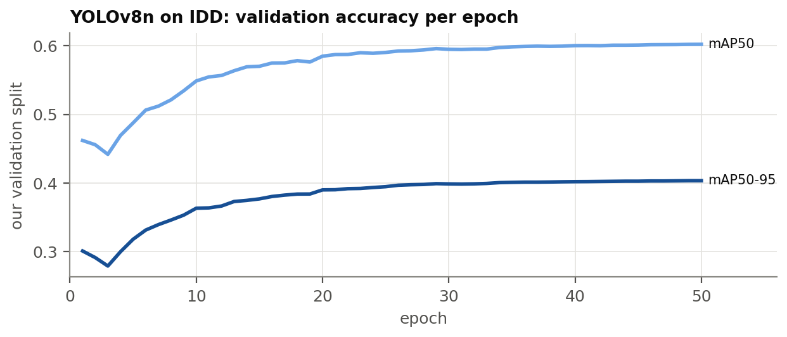

# Proposed System and Methodology {#sec:design}

This chapter describes what TrafficSense is made of and how a decision is made at one
intersection (@sec:architecture), how the work was carried out and checked (@sec:working), the
standards followed (@sec:standards) and the software and hardware used (@sec:system-details).
The design follows from three rules the project set itself before any code was
written, because the results will be examined and must be trusted:

1. **No invented data in the results path.** Every number in a result file is measured from the
   simulator or from a real model's answer. Test doubles exist only inside the test suite.
2. **Fail loudly.** If the LLM server is down, an answer cannot be parsed, a file is missing or
   a setting is invalid, the run stops with an error or, where a fallback is part of the design,
   the fallback is counted and reported. Nothing silently falls back to a default.
3. **Every result records where it came from**: controller, model as reported by the server,
   seed, scenario, run length, git commit and time, and for LLM runs the number of calls,
   failures and the latency.

## Proposed System {#sec:architecture}

@fig:architecture shows the components. The **CityFlow engine** simulates every vehicle and is
the only place where metrics are measured. An **environment wrapper** around it parses the road
network, enforces signal timing and computes metrics. Controllers do not read the engine
directly; they read lane counts through an **observation layer**, which returns either the exact
counts or, in the camera experiment, counts degraded by the detector's measured errors
(@sec:camera-design). A **controller** decides the next phase for each intersection. The LLM
controllers are built on top of **MaxPressure's ranking** of phases, ask an **LLM agent** per
intersection, and pass its answer through a **guard** and the timing rules. Each run writes its
results to `outputs/`, from which the dashboard, the documentation and this report are
generated.

{#fig:architecture width=100%}

The code is a Python package, `trafficsense`, with sub-packages for the simulator wrapper
(`sim`), the controllers (`control`), the LLM clients and prompts (`llm`), perception
(`perception`), the dashboard (`dashboard`) and the report tooling (`report`). Settings and paths
come from YAML files in `configs/`; no path is hard-coded.

### Simulation Layer {#sec:sim-layer}

**Road network and phases.** The wrapper reads a CityFlow road network and builds, for each
intersection, its incoming lanes, the movements (straight, left, right) and which movements each
phase serves. In the CoLLMLight networks and in ours, phase 0 is a 5 s transition phase in which
only the kerb-side free turn may move, and phases 1–8 are green phases. The transition phase is
detected from the network, not assumed.

**Signal timing.** CityFlow switches a signal instantly when told to, so the wrapper inserts the
transition phase on every change and enforces a minimum green of
10<!--=cfg.signal.min_green--> s and a maximum green of 60<!--=cfg.signal.max_green--> s for
every controller. The tuned MaxPressure and all LLM controllers use their own, longer minimum
green of 15<!--=cfg.mp.min_green--> s (@sec:baselines).

**Metrics** are measured from the engine at every second (@sec:metrics).

### The Multi-Agent Decision Loop {#sec:loop}

Each signalised intersection is controlled by its own agent. Every
5<!--=cfg.mp.interval--> s of simulated time, every intersection whose current green has lasted
at least the minimum green is asked for its next phase. One decision goes through five steps
(@fig:loop):

{#fig:loop width=100%}

1. **Observe.** The agent receives a short text describing its own intersection and its
   neighbours (@sec:cooperation). For each phase it may choose, it is given the phase's
   **pressure** (stopped vehicles the phase would serve minus stopped vehicles on their exit
   roads) and its **queue** (stopped vehicles it would serve), so that it needs no arithmetic.
   The pre-registered controller's prompts averaged
   277<!--=docs/llm_benchmark.md | llm_benchmark | guarded_v3 & llama3.2:3b | Prompt tokens--> tokens
   in the benchmark.
2. **Reason.** The prompt is sent to a local model through Ollama's native `/api/chat` endpoint
   with a JSON schema that restricts the answer to the allowed phase numbers and a short
   reason. Sampling uses temperature 0 and a fixed seed, a context of
   2048<!--=cfg.llm.num_ctx--> tokens, at most 128<!--=cfg.llm.num_predict--> answer tokens and a
   timeout of 60<!--=cfg.llm.timeout_s--> s; the model's "thinking" mode is switched off.
3. **Act.** The answer is parsed and checked: the phase must be one of those offered and the
   reason must be at most 15<!--=code.reason_words.guided_v3--> words. A failure (timeout, invalid JSON, a phase not offered, a
   reason that is too long) is counted by type. In the hybrid controllers, a failed call applies
   MaxPressure's choice for that decision and is reported as such.
4. **Enforce.** The chosen phase is requested from the wrapper, which inserts the transition and
   applies the green limits.
5. **Log.** The decision is written to the run's `decisions.jsonl`: the state the agent saw,
   MaxPressure's ranking and pressures, the raw answer, its latency and token counts, whether
   the guard intervened, and the phase applied.

All agents share one GPU, so the calls of one decision round run one after another. The
pre-registered selection rule therefore sets the decision interval to the shortest multiple of
the transition time that is at least the model's 95th-percentile latency times the number of
intersections (@sec:llm-selection). The simulator waits during calls; slow models make a run
take longer in wall-clock time but do not change the simulated traffic.

### Cooperation Through Neighbour Information {#sec:cooperation}

Following CoLLMLight, cooperation is through the prompt. For each neighbouring intersection,
the agent is told the neighbour's current phase, how many vehicles are stopped on the
neighbour's approaches heading towards this intersection and how many of those have green, and
how many vehicles are stopped on this intersection's road into the neighbour. The agent can thus
see a platoon about to be released towards it, or a neighbour whose approach from this
intersection is full. An example prompt, rendered by the controller's own code from a real
simulator state, is in @sec:app-prompts.

### Controller Variants {#sec:arms}

The project compared six LLM controller designs ("arms"). They differ in how much the LLM decides
and in the prompt version (@sec:app-prompts).

::: {#tbl:arms}
| Arm | Controller | What the LLM chooses | Prompt |
|:-------------|:--------------------|:------------------------|:--------------------------------|
| v1 | `llm_v1` | any green phase | v1: per-movement counts, vehicle types, neighbours |
| v2 | `llm_cooperative` | any green phase | v2: shorter; pressure and queue per phase |
| hybrid | `llm_guided_mp` | MaxPressure's top 2 or keep current | guided |
| v3 | `llm_v3` | any green phase | v3 = v2 with two lines fixed |
| hybrid_v3 | `llm_guided_mp_v3` | MaxPressure's top 2 or keep current | guided_v3 |
| guarded_v3 | `llm_guarded_mp` | as hybrid_v3, then the guard | guided_v3 |

: The LLM controller designs. The pre-registered final design round compared the last three.
:::

**Plain arms** (v1, v2, v3) let the LLM choose any green phase. **Hybrid arms** let MaxPressure
propose and the LLM decide: MaxPressure ranks the phases by pressure, and the LLM is offered
MaxPressure's two best phases and keeping the current phase. The **guarded arm** adds a check:
the LLM's choice is applied only if its pressure is close enough to the best phase's,

$$P(\text{LLM's phase}) \ge P_{\text{top}} - (1 - r)\,\lvert P_{\text{top}} \rvert,$$

with $r$ = 0.8<!--=cfg.guard.ratio--> in the configuration, i.e. within
20<!--=cfg.guard.margin-->% of the top pressure. The absolute value keeps the top phase
acceptable when every pressure is negative. Otherwise MaxPressure's choice is applied and the
override is counted. The guard was added because the small models in the earlier rounds
preferred low-pressure phases (@sec:res-bench); it limits how much harm such a choice can do.

### Ambulance Handling {#sec:ambulance-design}

In the emergency scenarios, ambulances are part of the traffic (@sec:emergency-scenario). An
ambulance on an incoming lane within 150<!--=cfg.amb.range--> m of the stop line is detected.
For the hybrid and guarded arms:

* the prompt lists each detected ambulance with its movement, its distance to the stop line and
  the phases that serve it, and the system prompt adds one sentence: "Ambulances, if listed, must
  get through quickly: give green to a phase that serves them.";
* if no offered phase serves the ambulance, the best-ranked phase that does is added to the
  options;
* in the guarded arm, a phase that serves a listed ambulance is exempt from the guard, so the
  guard cannot block priority.

The non-LLM competitor, `preemption_mp`, is MaxPressure with a rule: when an ambulance is
detected in the same way, the phase that serves it with the highest pressure is given green,
within the same minimum and maximum green. Ambulance positions are assumed to come from a
separate channel (GPS or V2X) and are not passed through the camera-noise layer.

### Camera-Noise Observation Layer {#sec:camera-design}

To test controllers on realistic counts without changing the traffic, the observation layer can
replace the engine's lane counts with noisy ones. Every time a controller observes, a fresh
snapshot is drawn for the whole network: each vehicle is detected with a class-dependent
probability, a detected vehicle may be given another class (a vehicle labelled as a pedestrian
is lost from the count), and each road gains a random number of phantom stopped vehicles. All
the rates come from the detector's measured errors (@sec:error-model). The simulator itself
stays exact, so every metric is still measured from the true traffic.

### Dashboard {#sec:dashboard}

A Streamlit dashboard presents the results. It reads only files in `outputs/` (and the detector
weights), and every chart and number carries a source chip naming the file it came from. Its
four pages show the headline result, live detection on video with the trained detector, a
side-by-side replay of two controllers on the same traffic, and the result tables; screenshots
of all four are in @sec:res-dashboard. A test renders every page and fails if any number shown
does not appear in the files the page read.

## Working Methodology {#sec:working}

The work proceeded in steps, and each step was checked before the next one relied on it:

1. **Simulation** (@sec:simulation). The simulation pipeline was validated against the
   CoLLMLight authors' own code before any result was trusted.
2. **Scenario** (@sec:indian-scenario). An Indian-style network was built, every parameter
   with its source, and its demand levels were calibrated by a rule fixed in advance. The
   classical baselines were then tuned on it (@sec:baselines).
3. **Perception** (@sec:perception). A detector was trained on Indian street images and its
   errors were measured on held-out drives and turned into an error model.
4. **Experimental method** (@sec:method). Scenarios, seeds, metrics and the statistical
   treatment are the same for every controller.
5. **Pre-registration** (@sec:prereg). The plan and decision rule of every study were committed
   before its runs; the few additions made later are stated and labelled.

### Simulation {#sec:simulation}

A controller comparison is only as good as the simulator and the scenario behind it. This section
checks that our simulation pipeline gives the same answers as an independent implementation;
@sec:indian-scenario then describes the Indian test network and where each of its parameters
comes from. How the classical baselines were tuned on it, before the LLM controllers were tested,
is reported with the results (@sec:baselines).

#### CityFlow and what it can represent {#sec:sim-limits}

CityFlow [@zhang2019cityflow] is a microscopic traffic simulator designed for signal-control
research: it moves every vehicle every second with a car-following model, is fast enough for
hour-long runs on a laptop, and is the simulator of CoLLMLight and most RL work. It is
**lane-based**: every vehicle drives in one lane and follows the vehicle in front. It cannot
represent vehicles straddling lanes, two-wheelers filtering between cars or queuing several
abreast, and it ignores vehicle width in its dynamics. Our Indian scenario therefore models the
Indian **vehicle mix** (sizes, headways, accelerations) but not Indian **driving behaviour**. Its
results describe "a lane-based simulation with an Indian vehicle mix", and capacities measured
in it are probably lower in vehicles per hour than on a real road with the same mix.

We run CityFlow with lane changing switched off. With lane changing on, CityFlow is not exactly
repeatable: the same run, repeated with identical inputs, gives slightly different travel times.
With it off, the same phase sequence always gives exactly the same run, which we verified by
re-running every deterministic experiment from a fresh copy of the repository
(@sec:app-repro).

#### Validation against CoLLMLight's code {#sec:validation}

Before trusting any comparison, we checked our environment wrapper, signal timing and metrics
against an independent implementation: the CoLLMLight authors' own code (commit `ce204a9`).

**Method.** Their FixedTime and MaxPressure baselines were run unmodified in a separate Python
environment with their pinned library versions. Their configuration imports every agent class,
including the neural and LLM ones, so those imports were replaced by inert stubs; FixedTime and
MaxPressure never call them. Our own environment was then driven exactly as theirs: the same 4
phases, one decision every 30<!--=val.matched.interval--> s, a 5 s transition before every switch, no minimum or maximum
green, lane changing on, and **the same CityFlow seed** their run drew. Their metric definitions
differ from ours (they measure travel time per intersection approach rather than per trip, sum
queues over the network, and sample at their decision times), so every matched run was scored twice: with our
metrics and with a line-by-line reimplementation of theirs.

**Result.** @tbl:validation compares one run of each implementation under their metric
definitions. Throughput, queue length and waiting time are identical floating-point numbers for
both controllers on all three datasets. Average travel time under their definition is identical
in all but one of the six runs; there, and in CityFlow's own average travel time, the differences
are in the sixth significant digit or beyond. These comparisons need lane changing on, and with
it CityFlow is not exactly repeatable: repeating the same run, in their code or ours, moves the
average travel time by similar or larger amounts, while throughput and their queue length never
changed (@sec:app-repro). The remaining differences are therefore within the simulator's
own noise. (An earlier draft attributed them to extra read-only queries; the fresh-clone check
showed that test could not separate the two.) We therefore consider the pipeline validated.

::: {#tbl:validation short="Our environment against CoLLMLight's code"}
<!-- BEGIN:tab_validation -->
| Dataset | Controller | ATT | Throughput | Queue | Waiting | CityFlow ATT |
|-----------------|---------------|-------------|--------------|-------------|-------------|--------------:|
| synthetic_4x4 | Fixedtime | identical | identical | identical | identical | 3.1e-07 rel. |
| synthetic_4x4 | MaxPressure | 3.7e-06 rel. | identical | identical | identical | 9.9e-07 rel. |
| Jinan 3x4 | Fixedtime | identical | identical | identical | identical | 1.8e-07 rel. |
| Jinan 3x4 | MaxPressure | identical | identical | identical | identical | 1.4e-06 rel. |
| hangzhou_4x4 | Fixedtime | identical | identical | identical | identical | identical |
| hangzhou_4x4 | MaxPressure | identical | identical | identical | identical | 4.6e-06 rel. |
<!-- END:tab_validation -->

: Our environment against CoLLMLight's code, both driven the same way and scored with their
metric definitions. "identical" means equal floating-point numbers; otherwise the relative
difference is shown. "CityFlow ATT" is the engine's own average travel time.
:::

The validation also corrected one of our own earlier claims. We had written that CityFlow's
average travel time leaves out vehicles that never entered the network. It does not: it averages
over every generated vehicle, timed from its scheduled start, including vehicles still waiting
to enter. A unit test now reproduces the engine's number from the flow file, and every metric
description was corrected.

#### A bug in CoLLMLight's FixedTime baseline {#sec:fixedtime-bug}

CoLLMLight's fixed-time agent computes its next action as `(cur_phase + 1) % 4`, where `cur_phase`
is CityFlow's phase index (1–4). Actions, however, are numbered from 0 and the environment adds 1
again. Phase 1 therefore leads to phase 3 and phase 3 back to phase 1: the controller alternates
between the two east–west phases, and **north–south traffic never gets a green**. Their own action
log confirms it for every intersection over the whole hour. @tbl:fixedtime-bug shows what this
does to the numbers: a correct 4-phase cycle on the same 30<!--=val.matched.interval--> s grid has a far lower travel time on
the two real-world datasets. Any comparison with CoLLMLight's published fixed-time numbers must
take this into account; we use only our own, correct fixed-time controllers.

::: {#tbl:fixedtime-bug short="CoLLMLight's FixedTime against a correct 4-phase cycle"}
<!-- BEGIN:tab_fixedtime_bug -->
| Dataset | Controller | CityFlow ATT (s) | ATT, CoLLMLight's definition (s) | Throughput, CoLLMLight's definition |
|------------------|---------------------------|--------------:|-------------------:|-------------------:|
| Synthetic 4x4 | CoLLMLight's FixedTime (bug: E-W only) | 1612.0 | 1192.5 | 751 |
| Synthetic 4x4 | CoLLMLight's MaxPressure | 1263.3 | 683.1 | 2505 |
| Synthetic 4x4 | Correct 4-phase FixedTime, same 30 s grid | 1420.6 | 875.6 | 1724 |
| Jinan 3x4 | CoLLMLight's FixedTime (bug: E-W only) | 1258.0 | 1239.3 | 1786 |
| Jinan 3x4 | CoLLMLight's MaxPressure | 317.8 | 273.2 | 4187 |
| Jinan 3x4 | Correct 4-phase FixedTime, same 30 s grid | 479.6 | 441.2 | 4027 |
| Hangzhou 4x4 | CoLLMLight's FixedTime (bug: E-W only) | 1054.7 | 1002.8 | 1526 |
| Hangzhou 4x4 | CoLLMLight's MaxPressure | 365.7 | 325.3 | 2751 |
| Hangzhou 4x4 | Correct 4-phase FixedTime, same 30 s grid | 667.9 | 616.0 | 2450 |
<!-- END:tab_fixedtime_bug -->

: CoLLMLight's FixedTime (which serves east–west only) against a correct 4-phase cycle with the
same 30<!--=val.matched.interval--> s decisions, and their MaxPressure for reference. One run per dataset, CoLLMLight's
settings.
:::

The validation also showed why the Synthetic 4x4 dataset is unusual. One of its entry roads
carries 2660<!--=docs/validation.md | capacity | Demand needing its straight lane | veh / h-->
vehicles per hour that all need a single straight lane, whose stop line discharges at most
1440<!--=docs/validation.md | capacity | Stop-line saturation flow | veh / h--> vehicles per hour
even with a permanent green. No signal plan can clear it, so a large entry queue is a property of
the dataset. For this reason the comparisons in this report use Jinan 3x4 (real flow) and our
Indian network, and use Synthetic 4x4 only for validation.

### Scenario {#sec:indian-scenario}

#### Network

The test network (@fig:network, @tbl:network) is a 2 × 2 grid generated with CityFlow's own grid
generator. India drives on the left and the generator builds right-hand traffic, but a square grid
is mirror-symmetric: a right-hand network is the mirror image of a left-hand one, and the
simulation is the same with the turn labels swapped. CityFlow's right turn (kerb side, allowed in
every phase) plays the role of India's **free left turn**, and its left turn (across opposing
traffic, protected phase) plays the role of India's **right turn**.

{#fig:network short="The Indian 2x2 network" width=48%}

::: {#tbl:network short="Network and signal parameters of the Indian 2x2 scenario"}
<!-- BEGIN:tab_network -->
| Parameter | Value | Source |
|----------------------------------|-------------------------------:|----------------------------------|
| Grid | 2 × 2 signalised intersections | project specification |
| Spacing between intersections | 200 m | project specification |
| Entry and exit roads | 200 m | assumption (same as spacing) |
| Lanes per direction | 3 (one per turn) | CityFlow generator layout |
| Lane width | 3.0 m | project specification |
| Speed limit | 12.5 m/s (45 km/h) | assumption within the 11–13 m/s range |
| Centre to stop line | 12 m | assumption (three lanes plus margin) |
| Phases | 0 = 5 s transition (free turns only); 1–8 green | CityFlow generator |
| Minimum / maximum green | 10 s / 60 s (MaxPressure and LLM arms: minimum 15 s) | configs/default.yaml |
<!-- END:tab_network -->

: Network and signal parameters of the Indian 2x2 scenario (`configs/scenarios/indian_2x2.yaml`).
:::

#### Vehicles

Each vehicle type has its own length, gap, headway, speed and acceleration (@tbl:mix). The shares
are the 2006 modal share of Chennai traffic [@itrans2009], with bicycles removed (not modelled)
and buses and trucks split equally (an assumption). Lengths and widths are the average Indian
dimensions given by Umapathi and Khatawkar [@umapathi2019pcu]. The car's gap, headway and
accelerations are CityFlow's defaults; the other types' values are assumptions chosen to be
plausible (small vehicles follow closer and accelerate faster) and were not tuned to favour any
controller.

::: {#tbl:mix}
<!-- BEGIN:tab_mix -->
| Type | Share | Length (m) | Width (m) | minGap (m) | headwayTime (s) | maxSpeed (m/s) |
|--------------------|----------:|-----------:|----------:|-----------:|-----------------:|--------------:|
| motorcycle | 45.1% | 1.67 | 0.7 | 1.0 | 1.0 | 12.5 |
| auto_rickshaw | 17.6% | 3.2 | 1.4 | 1.5 | 1.5 | 11.1 |
| car | 30.8% | 3.72 | 1.44 | 2.5 | 1.5 | 12.5 |
| bus | 1.6% | 10.1 | 2.43 | 2.5 | 2.0 | 11.1 |
| truck | 4.9% | 7.5 | 2.35 | 2.5 | 2.0 | 11.1 |
<!-- END:tab_mix -->

: Vehicle types of the Indian scenario. Share = normalised share of all vehicles.
:::

#### Demand

Vehicles arrive as a Poisson process on each of the 8 entry roads. East–west is the major road:
each east or west entry has weight 1.0<!--=scn.entry_weights.W--> and each north or south entry
0.6<!--=scn.entry_weights.N-->. At every intersection a vehicle goes straight with probability
0.60<!--=scn.turn_probabilities.go_straight-->, takes the free (left) turn with
0.25<!--=scn.turn_probabilities.turn_right--> and the right turn with
0.15<!--=scn.turn_probabilities.turn_left-->; these shares are assumptions. Each seed produces a
different flow file, so seeds give genuinely different traffic.

#### Demand calibration {#sec:calibration}

The demand levels were not chosen by eye. The goal was an off-peak level that is clearly below
capacity and a peak level near capacity that still drains. A three-step procedure, fixed before
it was run, set them:

1. **Measure capacity.** Saturation flows were measured in the simulator with the vehicle mix by
   letting a queue discharge after a long red (@tbl:capacity).
2. **Sweep demand under MaxPressure.** For total demands from
   1000<!--=docs/indian_scenario.md | sweep | 1000 & 0.05 | Demand--> to
   14000<!--=docs/indian_scenario.md | sweep | 14000 | Demand--> vehicles per hour and three
   seeds, MaxPressure ran for an hour and then until the network emptied (@fig:calibration).
3. **Apply the rule.** The network "drains" if at most 2<!--=cal.rule.backlog_pct-->% of the vehicles are still waiting to
   enter at the end of the hour and it empties within 900<!--=cal.rule.drain_s--> s after arrivals stop, on every seed.
   The lowest swept demand that does not drain is
   $R^*$ = 5500<!--=cal.r_star--> veh/h. Peak is the largest swept demand at or below 0.9<!--=cal.rule.peak_fraction--> × $R^*$
   that drains, 4750<!--=cal.peak--> veh/h; off-peak is 0.5<!--=cal.rule.offpeak_over_peak--> × peak,
   2375<!--=cal.offpeak--> veh/h.

{#fig:calibration short="Demand calibration under MaxPressure" width=100%}

::: {#tbl:capacity short="Capacity of the Indian network, measured in the simulator"}
<!-- BEGIN:tab_capacity -->
| Quantity (mixed traffic, measured) | Value |
|--------------------------------------------------------------|-------------------------------------:|
| Saturation flow, straight lane | 2103 veh/h |
| Saturation flow, protected-turn lane (Indian right turn) | 2024 veh/h |
| Start-up lost time (mean of both lanes) | 1.88 s |
| Entry admission limit (CityFlow insertion) | 1341 veh/h |
<!-- END:tab_capacity -->

: Capacity of the Indian network with its vehicle mix, measured in the simulator.
:::

"Near capacity" here means near the capacity **of MaxPressure as configured**, not of the
intersections. A controller-independent check with Webster's critical flow ratio shows that the
peak level uses only about
0.55<!--=docs/indian_scenario.md | webster_reference | Peak, 4750 | Value | 1--> of Webster's
capacity limit. MaxPressure breaks down earlier because it switches often and every switch costs
5 s of transition: under the earlier 10 s minimum green, a third of each intersection's time was
transition (@sec:baselines). This is why a well-timed fixed plan can keep up with MaxPressure at
peak.

#### Emergency scenario {#sec:emergency-scenario}

The emergency scenarios add ambulances to the normal flow files of the peak level without
changing any other vehicle. Ambulances arrive at 6<!--=scn.emergency.veh_per_hour--> per hour over
the whole network (an assumption), with routes drawn like the normal traffic, from a random
generator seeded separately so that the normal traffic does not depend on them. An ambulance is a
5<!--=scn.emergency_vehicle_types.ambulance.length--> m van at the 12.5<!--=scn.emergency_vehicle_types.ambulance.maxSpeed--> m/s
lane limit. Over seeds 0–4 there are 37<!--=e.mp.amb_all_n--> ambulances, of which
29<!--=e.mp.amb_n--> are **signal-relevant**: their route crosses at least one movement a signal
controls (the others only make free turns, which no signal affects). CityFlow has no notion of
yielding: other vehicles do not pull over and, with lane changing off, the ambulance cannot
overtake. Only the signal can help it, which is exactly what the controllers are tested on.

### Perception {#sec:perception}

A deployed version of this system would not get exact vehicle counts from a simulator; it would
count vehicles with a camera and a detector. The perception part of the project has a narrow,
measurable purpose: train a detector on real Indian street images, measure the errors it makes in
the terms a signal controller cares about (missed vehicles, invented vehicles, wrong classes),
and turn those measurements into an error model for the simulation experiment of
@sec:res-camera. The detector is not used to control signals directly.

#### Dataset {#sec:idd}

We use the detection part of the **India Driving Dataset** (IDD) [@varma2019idd], collected by
IIIT Hyderabad and Intel from vehicles driving in Indian cities. It has bounding boxes for road
users including auto-rickshaws, which most Western datasets lack. IDD is filmed from a moving
vehicle, not from a pole at a junction; we return to this limitation below.

**Classes.** We keep 7 classes, mapped one-to-one from IDD: car, motorcycle, autorickshaw, bus,
truck, bicycle and person. IDD's `rider` boxes are dropped: a rider sits on a two-wheeler that has
its own box, and counting riders would double-count road users, while labelling them `person`
would make every two-wheeler look like a pedestrian. The catch-all `vehicle fallback`, the rare
`caravan`, `trailer` and `train` classes, animals, traffic signs and traffic lights are dropped
as well; regions that contain them become background. These rules were written down before any
conversion code existed.

**Splits.** IDD's official test labels are withheld, so the official test split cannot measure
anything. Our **test** split is the official validation split; our **validation** split is
10<!--=cfg.det.val_pct-->% of the official training *drives*, chosen per camera group with a fixed seed. Splitting by
drive rather than by frame matters: consecutive frames of one drive are near-duplicates, and a
frame-level split would leak them into training and flatter the validation scores. The test
split was evaluated once, after every choice (including the confidence threshold) had been
frozen on the validation split. @tbl:idd gives the sizes.

::: {#tbl:idd}
<!-- BEGIN:tab_idd -->
| Our split | From | Used for | Images | Drives | Boxes |
|-----------|--------------------------|--------------------------|-----------:|-----------:|------------:|
| train | official train minus held-out drives | training | 28,384 | 393 | 247,051 |
| val | held-out official-train drives | early stopping, threshold | 3,185 | 45 | 28,722 |
| test | official val | final numbers, used once | 10,225 | 119 | 88,755 |
<!-- END:tab_idd -->

: Our IDD splits after the class mapping. Drives = recorded sequences.
:::

**Image size.** Training and evaluation use images of
640<!--=cfg.imgsz--> pixels on the long side, which is what fits the GTX 1650. A
full-HD frame is shrunk three times, so a distant motorcycle keeps only a third of its height in pixels.
We therefore report errors by object size, so that this cost is visible rather than hidden in an
average. The dataset itself stays outside the repository; a resized copy was made once to cut
image-reading time.

#### Training {#sec:training}

The detector is YOLOv8n [@jocher2023yolov8] (about 3 million parameters), starting from weights
pre-trained on COCO, whose classes already include cars, buses, trucks, motorcycles, bicycles and
people. A short probe run decided the batch size: twice the batch needed more memory than the 4 GB card
has and was slower, so training used batch 8<!--=cfg.det.batch-->. Mixed-precision training was
switched off because GTX 16-series cards produce invalid (NaN) losses with it; no invalid loss
occurred. Training ran for 50<!--=cfg.det.epochs--> epochs with early stopping after
10<!--=cfg.det.patience--> epochs without improvement on our validation split.

The full run took 13.3<!--=d.train_h--> hours. Early stopping did not trigger: validation accuracy
was still rising very slowly at the end (@fig:det-training), and the best epoch was
49<!--=d.best_epoch-->. An earlier engineering problem is worth recording because it cost more
time than the training itself: reading images from the external hard disk through WSL was limited
to a few dozen images per second by a fixed cost per file, most of it Windows Defender's on-access
scan. Excluding the dataset folder from the scan removed the bottleneck, and the GPU, not the
disk, became the limit.

{#fig:det-training short="Validation accuracy during training" width=100%}

#### Camera error model {#sec:error-model}

The measurements are turned into the parameters of the observation-noise layer
(@sec:camera-design), stored in `outputs/perception/error_model.json` and read from there by the
simulation, never typed into code:

* **Detection probability** of each class, $p_{\text{detect}} = 1 - \text{miss rate}$.
* **Label probabilities**: the probability of each predicted class given the true class and that
  the object was detected (the normalised rows of the confusion matrix).
* **False detections**: a Poisson count per road and snapshot whose mean is the measured number
  of false detections per image of each class.

Two camera levels are defined (@tbl:camera-params). The **junction** level uses detection rates
measured on medium and large objects, because queued vehicles near a stop line are close to a
camera on a pole. The **crowded / far** level uses the rates over all objects, dominated by
distant ones. Both use the measured false-detection rates and label probabilities.

::: {#tbl:camera-params short="Camera error parameters per detector class"}
<!-- BEGIN:tab_camera_params -->
| detector class | junction p_detect | crowded p_detect | false det. per road and snapshot |
|-----------------------------------|---------------------:|---------------------:|---------------------:|
| car | 0.936 | 0.568 | 0.222 |
| motorcycle | 0.913 | 0.567 | 0.271 |
| autorickshaw | 0.944 | 0.598 | 0.070 |
| bus | 0.907 | 0.632 | 0.039 |
| truck | 0.832 | 0.537 | 0.079 |
| bicycle (label only) | – | – | 0.006 |
<!-- END:tab_camera_params -->

: Camera error parameters used in the simulation, per detector class.
:::

**Limitation.** These are measured errors of our detector on dash-camera images. A camera on a
pole at a junction sees from a different height and angle, with different occlusion. The error
model is therefore a measured *proxy* for a junction camera, not its true error, and the two
levels bracket a range rather than predict one value.

### Experimental Method {#sec:method}

A comparison between a new controller and established ones is easy to bias without meaning to:
by tuning the new method until it wins, by choosing the scenario or the metric after seeing the
results, or by comparing against a weak baseline. This section describes the safeguards used and
defines every metric; the pre-registration of every study is in @sec:prereg.

#### Scenarios, seeds and run length {#sec:seeds}

Every run simulates 3600<!--=cfg.steps--> s. The Indian off-peak and peak scenarios and Jinan 3x4
use seeds 0, 1 and 2; the emergency scenario uses seeds 0–4 because ambulances are few. On the
Indian network each seed is a different flow file, so seeds differ in traffic. Jinan has one
fixed flow file, so the deterministic baselines give identical results on every seed; only the
LLM runs vary there. LLM runs use the run seed as the sampling seed at temperature 0. Even so,
Ollama on a GPU is not bit-for-bit deterministic: a repeated run gives slightly different
answers in a few calls, after which the traffic diverges. Every decision is logged, so each LLM
run can be replayed exactly from its log, and the dashboard's replays are checked to reproduce
their runs' metrics.

The full experiments comprise 67<!--=f.runs--> runs (Indian off-peak and peak: all baselines and
both LLM arms; Jinan: baselines and the main arm; emergency: five controllers on five seeds). The
camera-error experiment comprises 130<!--=c.runs--> runs.

#### Metrics {#sec:metrics}

All traffic metrics are measured from the simulator, never estimated.

* **Average travel time (ATT)**: CityFlow's `get_average_travel_time()` at the end of the run. It
  averages over every vehicle generated so far, from its scheduled start to its arrival or to the
  end of the run, *including time spent waiting to enter the network*. A controller that blocks
  an entry therefore cannot hide the delay it causes. ATT is the primary metric.
* **Queue length**: at each second, the number of waiting vehicles (speed below 0.1<!--=code.stop_speed--> m/s) on an
  intersection's incoming lanes; averaged over seconds and intersections.
* **Waiting time**: per vehicle, the seconds spent with speed below 0.1<!--=code.stop_speed--> m/s, averaged over
  vehicles.
* **Throughput**: vehicles that finished their trip within the hour.
* **Ambulance travel time**: finish time minus scheduled start, per signal-relevant ambulance
  (the same convention as ATT), pooled over seeds; also its median and the time it spent
  stopped. Each controller is also compared with preemption ambulance by ambulance.
* **LLM decision statistics**: calls, failures by type, mean and 95th-percentile latency, how
  often the LLM's answer differs from MaxPressure's choice, how often the guard overrode it, and
  how often the *applied* phase differs from MaxPressure's. These describe decisions; they are
  not traffic metrics.
* **Detector metrics**: mAP50 and mAP50-95 (Ultralytics), and precision, recall, miss rate and
  false detections per image from our own matching (@sec:res-detector).

Results are given as mean ± sample standard deviation over seeds. Because every controller sees
the same flow file on the same seed, the most informative comparison is **paired by seed**: each
arm's ATT minus MaxPressure's ATT on the same seed.

#### Fairness of the comparison {#sec:fairness}

* **Same timing.** MaxPressure, preemption and all LLM arms decide on the same 5<!--=cfg.mp.interval--> s
  grid with the same 15<!--=cfg.mp.min_green--> s minimum green and
  60<!--=cfg.signal.max_green--> s maximum green, so they differ only in how they choose a phase.
* **Same traffic.** All controllers see the same flow file on the same seed, and ambulances are
  appended to the normal flow without changing any other vehicle.
* **Baselines tuned first.** MaxPressure and Webster were tuned (@sec:baselines) before any LLM
  run, and Webster's plan uses a perfect count of the simulated demand.
* **Clean runs.** Batch runs refuse to start from a git tree with uncommitted changes, so every
  result can be traced to a commit. In the LLM benchmark, every loaded model was unloaded and the
  GPU had to be idle before each model was tested.
* **Repeatability of baselines.** Every baseline run of the full experiments that repeats an
  earlier run (same scenario, controller, settings, seed and flow file) was compared with it:
  27<!--=f.reproduced--> of 27<!--=f.reproduced_of--> are identical in every metric.

#### Statistical treatment {#sec:stats}

With three seeds per scenario (five with ambulances) a significance test has little power, and
none was pre-registered. Differences are therefore reported as measured, with their spread and,
for paired comparisons, the result on each seed. A difference is called a result only when it
has the same sign on every seed and is large compared with the seed-to-seed spread; smaller
differences are described as "within seed noise".

### Pre-registration {#sec:prereg}

**Pre-registration** means writing down the design of an experiment and the rule that decides
its outcome *before* running it, and committing that to version control so the order can be
checked [@nosek2018prereg]. It separates confirmatory results, which test a fixed hypothesis,
from exploratory ones, which suggest new hypotheses. Every major step of this project was
pre-registered, and each study's document records the commit at which its plan was fixed
(@tbl:prereg).

::: {#tbl:prereg}
| Study | Fixed before any of its runs |
|:-------------------|:-----------------------------------------------------------|
| Demand calibration | the "drains" criterion, the rule for $R^*$, peak and off-peak |
| MaxPressure tuning | the swept settings and the rank-based selection rule with its tie-break (commits `8414f9a`, `c7a6e34`) |
| LLM benchmark | the setup and the model-selection rule; reused unchanged in every round |
| Final LLM design round | the three arms, and that its pick goes to the full experiments even if worse than MaxPressure |
| Full experiments | arms, scenarios, seeds, run length and analysis (commit `694dc0c`) |
| Emergency experiment | ambulance rate, seeds, controllers and the primary metric |
| Detector | class mapping, splits, image size, training settings; threshold frozen on validation (`876076d`) before the single test evaluation |
| Camera-error experiment | noise model, levels, runs, analysis and checks (`91aa214`) |
| Model-size study | models, runs and tables, committed before its runs, but the study itself was added after the main results (exploratory) |

: What was fixed in advance for each study. Commit hashes refer to the project's git history.
:::

**The model-selection rule.** Each LLM benchmark run is a 600<!--=b.steps--> s run of the Indian
peak scenario, seed 0. A model is **eligible** if fewer than 2<!--=b.rule.fail_pct-->% of its
calls failed and its 95th-percentile latency is below 3<!--=b.rule.p95_s--> s; among eligible
models the one with the lowest mean queue per intersection is chosen, ties broken by travel
time. The decision interval is then the shortest multiple of the 5 s transition that is at
least the chosen model's 95th-percentile latency times the number of intersections, so that a
full round of decisions fits in real time on one GPU.

**Deviations and additions, stated openly.** Four things were not part of the original plans and
are labelled wherever they appear:

1. **Prompt v3 is a post-hoc fix.** After the first rounds showed that the prompts never said
   which direction of pressure is better, two lines were changed (@sec:res-bench). The final
   design round, which used v3, was itself pre-registered and declared final.
2. **The `gemma4:e4b` hybrid arm is exploratory.** It failed the selection rule only on latency
   and was added to the full experiments, at the user's request, after their plan was fixed. It
   is labelled "exploratory, NOT selected by the rule" in every table.
3. **The model-size study** was planned after the main results and is exploratory.
4. **The camera-error decomposition** (one error source at a time) was added after the camera
   results had been read, to test an explanation offered for them; it is post-hoc.

## Standards {#sec:standards}

TrafficSense is a simulation and software study: it controls no signal in the field, so no
standard for traffic-signal equipment applies to it. @tbl:standards lists the formats,
definitions and practices it does follow. Each is used by the code itself, so a departure from it
would break a run, a test or a check.

::: {#tbl:standards short="Standards, formats and conventions followed"}
| Area | Standard or convention | Where and how it is used |
|:---------------|:--------------------------------|:------------------------------------------------|
| Road network and demand | CityFlow's road-network and flow file formats (JSON) | The Indian 2x2 network and its flows are generated in these formats and run by the unmodified engine; lane ids are `road_lane`; signals are under external control (`rlTrafficLight`) |
| Data interchange | JSON (RFC 8259); JSON Lines for logs | Every result file (`summary.json`), every decision log (`decisions.jsonl`, one object per line) and every LLM answer |
| LLM output | JSON Schema, through Ollama's structured-output `format` field | The answer must be an object with a phase from the allowed list and a short reason; our code parses and checks it again (@sec:loop) |
| Detector data | IDD annotations in Pascal VOC XML; the YOLO label format | `perception/idd.py` converts the one into the other (@sec:idd) |
| Detector metrics | COCO-style evaluation: mAP at IoU $0.5$ and averaged over IoU $0.5$ to $0.95$; COCO's object-size buckets | @sec:res-detector |
| Traffic metrics | CityFlow's average travel time; queue, waiting time and throughput as defined in @sec:metrics | Every result table |
| Experiment design | Pre-registration [@nosek2018prereg] | Every study (@sec:prereg) |
| Referencing | IEEE citation style | The reference list, through the IEEE citation style file of the report build |
| Licences | The open-source licences and terms of use of every tool, dataset and model | Chapter 3; the dataset and the model weights are not redistributed |

: Standards, formats and conventions the project follows.
:::

## System Details {#sec:system-details}

This section lists the software the system is built from and the hardware it ran on.

### Software Details {#sec:software}

@tbl:software lists the software. Python package versions are those pinned in the repository's
lock file (`requirements-lock.txt`), the environment every committed result was checked with;
the Ollama version is the one every local LLM run recorded; the report tools are those of the
last report build. The table is generated from those files. The controllers, the observation
layer, the experiment scripts and the dashboard are the project's own Python code.

::: {#tbl:software}
<!-- BEGIN:tab_software -->
| Component | Software | Version | Used for |
|------------------|---------------------------------|------------------------|------------------------|
| Operating system | Ubuntu in WSL2 on Windows 11 | 22.04.5 | everything below |
| Language | Python | 3.10.12 | all project code |
| Simulator | CityFlow, built from source | commit `81ee0f4` | traffic simulation |
| LLM server | Ollama, native `/api/chat` with a JSON schema | 0.40.3 | local LLM agents |
| Local LLMs | `llama3.2:3b` (selected), `qwen2.5:3b`, `gemma4:e4b`; `gemma3:4b` (round 1 only); `llama3.1:8b` (model-size study) | 4-bit quantised Ollama builds | signal-control agents |
| Hosted LLM | `nvidia/nemotron-3-ultra-550b-a55b`, NVIDIA's API | as served | exploratory model-size study |
| Detector | Ultralytics (YOLOv8n) | 8.4.183 | training and inference |
| Deep learning | PyTorch, torchvision (CUDA build) | 2.14.1+cu126, 0.29.1+cu126 | detector |
| Images and video | OpenCV, Pillow | 5.0.0.93, 12.3.0 | detector input, dashboard |
| Numerics | NumPy | 2.2.6 | metrics, statistics |
| Configuration | PyYAML | 6.0.3 | `configs/*.yaml` |
| HTTP | requests | 2.34.2 | Ollama and NVIDIA API calls |
| Charts | Matplotlib, Plotly | 3.10.9, 7.1.0 | report figures, dashboard charts |
| Dashboard | Streamlit | 1.65.0 | the four dashboard pages |
| Tests | pytest, Playwright (Chromium) | 9.1.1, 1.64.1 | test suite, dashboard layout tests |
| Report | pandoc, LibreOffice, pypdfium2 | 3.12.1, 25.8.6.2, 5.14.0 | this report (Word file and PDF) |
<!-- END:tab_software -->

: Software used, with versions.
:::

### Hardware Details {#sec:hardware}

All experiments, the detector training and this report ran on one laptop, the project laptop of
@tbl:hardware. A second laptop was used only to check that a stranger could reproduce the setup
from the README (@sec:app-repro); its figures are as reported by the project owner.

::: {#tbl:hardware}
<!-- BEGIN:tab_hardware -->
|  | Project laptop | Second laptop |
|----------------------------|------------------------------------|------------------------------------|
| Used for | every experiment, the detector training and this report | a reproduction check only (tests, detector weights, dashboard, one short LLM trial) |
| CPU | AMD Ryzen 5 4600H | AMD Ryzen 9 5900HS |
| Memory | 16 GB | 16 GB |
| GPU | NVIDIA GTX 1650, 4 GB | NVIDIA RTX 3050 Ti, 4 GB |
| Operating system | Windows 11 Home, WSL2, Ubuntu 22.04.5 LTS | Windows 11, WSL2, Ubuntu 22.04 |
<!-- END:tab_hardware -->

: Hardware. The project laptop's values are from the fresh-clone record; the second laptop's
are as reported by the project owner.
:::

**There is no field hardware.** No camera, signal controller or roadside computer was used:
every experiment is a simulation, and the detector was trained and tested on recorded images.

The GTX 1650 limits the work in two ways that shape the results: `gemma3:4b` does not fit in its
memory and runs partly on the CPU, and the stronger `gemma4:e4b` needs several seconds per call, too
slow for real-time control of four intersections. The LLM and the detector never ran on the GPU at
the same time.
