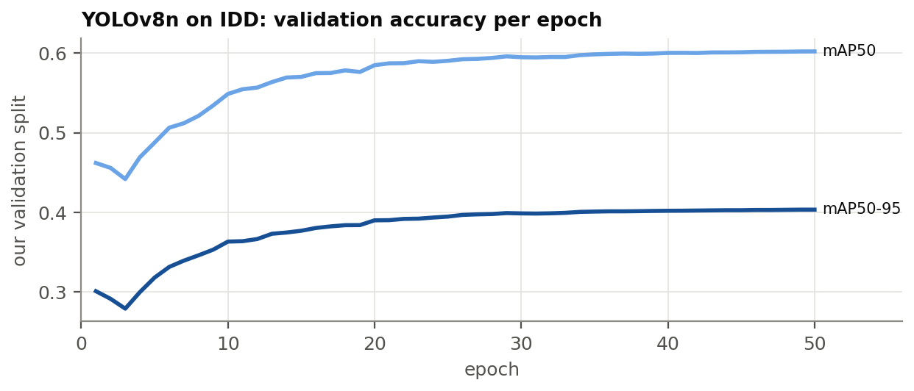

# Perception {#sec:perception}

A deployed version of this system would not get exact vehicle counts from a simulator; it would
count vehicles with a camera and a detector. The perception part of the project has a narrow,
measurable purpose: train a detector on real Indian street images, measure the errors it makes in
the terms a signal controller cares about (missed vehicles, invented vehicles, wrong classes),
and turn those measurements into an error model for the simulation experiment of
@sec:res-camera. The detector is not used to control signals directly.

## Dataset {#sec:idd}

We use the detection part of the **India Driving Dataset** (IDD) [@varma2019idd], collected by
IIIT Hyderabad and Intel from vehicles driving in Indian cities. It has bounding boxes for road
users including auto-rickshaws, which most Western datasets lack. IDD is filmed from a moving
vehicle, not from a pole at a junction; we return to this limitation below.

**Classes.** We keep 7 classes, mapped one-to-one from IDD: car, motorcycle, autorickshaw, bus,
truck, bicycle and person. IDD's `rider` boxes are dropped: a rider sits on a two-wheeler that has
its own box, and counting riders would double-count road users, while labelling them `person`
would make every two-wheeler look like a pedestrian. The catch-all `vehicle fallback`, the rare
`caravan`, `trailer` and `train` classes, animals, traffic signs and traffic lights are dropped
as well; regions that contain them become background. These rules were written down before any
conversion code existed.

**Splits.** IDD's official test labels are withheld, so the official test split cannot measure
anything. Our **test** split is the official validation split; our **validation** split is
10<!--=cfg.det.val_pct-->% of the official training *drives*, chosen per camera group with a fixed seed. Splitting by
drive rather than by frame matters: consecutive frames of one drive are near-duplicates, and a
frame-level split would leak them into training and flatter the validation scores. The test
split was evaluated once, after every choice (including the confidence threshold) had been
frozen on the validation split. @tbl:idd gives the sizes.

::: {#tbl:idd}
<!-- BEGIN:tab_idd -->
| Our split | From | Used for | Images | Drives | Boxes |
|--------|-------------------------------------|--------------------------|--------:|--------:|---------:|
| train | official train minus held-out drives | training | 28,384 | 393 | 247,051 |
| val | held-out official-train drives | early stopping, threshold | 3,185 | 45 | 28,722 |
| test | official val | final numbers, used once | 10,225 | 119 | 88,755 |
<!-- END:tab_idd -->

: Our IDD splits after the class mapping. Drives = recorded sequences.
:::

**Image size.** Training and evaluation use images of
640<!--=cfg.imgsz--> pixels on the long side, which is what fits the GTX 1650. A
full-HD frame is shrunk three times, so a distant motorcycle keeps only a third of its height in pixels.
We therefore report errors by object size, so that this cost is visible rather than hidden in an
average. The dataset itself stays outside the repository; a resized copy was made once to cut
image-reading time.

## Training {#sec:training}

The detector is YOLOv8n [@jocher2023yolov8] (about 3 million parameters), starting from weights
pre-trained on COCO, whose classes already include cars, buses, trucks, motorcycles, bicycles and
people. A short probe run decided the batch size: twice the batch needed more memory than the 4 GB card
has and was slower, so training used batch 8<!--=cfg.det.batch-->. Mixed-precision training was
switched off because GTX 16-series cards produce invalid (NaN) losses with it; no invalid loss
occurred. Training ran for 50<!--=cfg.det.epochs--> epochs with early stopping after
10<!--=cfg.det.patience--> epochs without improvement on our validation split.

The full run took 13.3<!--=d.train_h--> hours. Early stopping did not trigger: validation accuracy
was still rising very slowly at the end (@fig:det-training), and the best epoch was
49<!--=d.best_epoch-->. An earlier engineering problem is worth recording because it cost more
time than the training itself: reading images from the external hard disk through WSL was limited
to a few dozen images per second by a fixed cost per file, most of it Windows Defender's on-access
scan. Excluding the dataset folder from the scan removed the bottleneck, and the GPU, not the
disk, became the limit.

{#fig:det-training width=100%}

## Evaluation {#sec:det-eval}

**Operating point.** A detector outputs boxes with confidence scores; a controller needs a yes/no
decision per box. The confidence threshold was chosen on the validation split as the one that
maximises the mean F1 score over the 7 classes: 0.3<!--=d.conf--> (mean F1
0.620<!--=d.f1-->). The F1 curve is flat around this value, so the exact choice matters little.

**Matching.** On each test image, detections (sorted by confidence) are matched greedily to the
unmatched ground-truth box with the highest IoU of at least 0.5<!--=d.match_iou-->, ignoring the
class. A match with the same class is a true positive; a match with another class is a
**confusion**; an unmatched detection is a **false detection**; an unmatched ground-truth box is a
**miss**. Confidence intervals come from 1,000<!--=d.bootstrap_reps--> bootstrap resamples of
whole drives, not frames, so that correlated frames do not make them look tighter than they are.

**Results.** On the test split the detector reaches mAP50 0.563<!--=d.test.map50--> and mAP50-95
0.375<!--=d.test.map5095--> (validation: 0.602<!--=d.val.map50--> and
0.403<!--=d.val.map5095-->). @tbl:det-classes gives the per-class numbers. Precision is high
(few false detections) and recall is moderate: the detector undercounts.

::: {#tbl:det-classes}
<!-- BEGIN:tab_det_classes -->
| Class | Boxes | mAP50 | mAP50-95 | Precision | Recall | Miss rate | False det. / image |
|-------------------|----------:|---------:|-------------:|--------------:|----------:|---------:|----------:|
| car | 24,843 | 0.637 | 0.442 | 83.9% | 54.9% | 43.2% | 0.222 |
| motorcycle | 25,489 | 0.630 | 0.373 | 81.9% | 56.2% | 43.4% | 0.271 |
| autorickshaw | 7,782 | 0.652 | 0.461 | 82.0% | 56.0% | 40.2% | 0.070 |
| bus | 4,915 | 0.664 | 0.502 | 82.3% | 56.9% | 36.8% | 0.039 |
| truck | 7,077 | 0.576 | 0.412 | 72.9% | 48.3% | 46.3% | 0.079 |
| bicycle | 569 | 0.339 | 0.193 | 61.0% | 24.8% | 55.4% | 0.006 |
| person | 18,078 | 0.444 | 0.241 | 79.1% | 35.5% | 63.6% | 0.149 |
| all | 88,753 | 0.563 | 0.375 |  |  |  |  |
<!-- END:tab_det_classes -->

: Detector on the test split (official IDD validation set), per class. mAP from Ultralytics;
precision, recall, miss rate and false detections from our matching at confidence ≥ 0.3<!--=d.conf-->.
Recall = 1 − miss rate − confusion rate.
:::

**Most misses are small, distant objects** (@fig:det-size, @tbl:det-sizes). Small boxes are most
of the ground truth, and the detector misses
59<!--=d.size.motorcycle.small-->–76<!--=d.size.person.small-->% of them, against
1<!--=d.size.autorickshaw.large-->–22<!--=d.size.bicycle.large-->% of large boxes. This is the
cost of running at 640<!--=cfg.imgsz--> pixels named above. One camera group dominates the test set: the
`highquality_16k` camera supplies 3,633<!--=d.camera.hq.images--> images but
64,381<!--=d.camera.hq.gt--> of the boxes, 74<!--=d.camera.hq.small-->% of them small. The
overall per-class rates therefore mostly describe crowded scenes with distant objects. Confusions
are few and plausible: bicycles are labelled motorcycles, and buses, trucks and auto-rickshaws are
confused with each other and with cars. `person` has the highest miss rate, partly because
pedestrians are small and possibly because the model was taught not to fire on riders.

{#fig:det-size width=100%}

::: {#tbl:det-sizes}
<!-- BEGIN:tab_det_sizes -->
| class | Small: miss rate (boxes) | Medium | Large |
|---------------------------|------------------------:|-----------------------:|-----------------------:|
| car | 65.4% (15,489) | 9.1% (6,065) | 1.3% (3,289) |
| motorcycle | 59.0% (17,565) | 10.1% (6,250) | 3.8% (1,674) |
| autorickshaw | 63.6% (4,646) | 7.8% (2,106) | 1.1% (1,030) |
| bus | 70.8% (2,199) | 19.2% (1,141) | 2.1% (1,575) |
| truck | 73.0% (3,712) | 22.4% (1,820) | 10.2% (1,545) |
| bicycle | 71.9% (334) | 33.8% (198) | 21.6% (37) |
| person | 75.7% (14,180) | 20.7% (3,288) | 12.0% (610) |
<!-- END:tab_det_sizes -->

: Miss rate by object size (number of ground-truth boxes in brackets), test split.
:::

## Camera error model {#sec:error-model}

The measurements are turned into the parameters of the observation-noise layer
(@sec:camera-design), stored in `outputs/perception/error_model.json` and read from there by the
simulation, never typed into code:

* **Detection probability** of each class, $p_{\text{detect}} = 1 - \text{miss rate}$.
* **Label probabilities**: the probability of each predicted class given the true class and that
  the object was detected (the normalised rows of the confusion matrix).
* **False detections**: a Poisson count per road and snapshot whose mean is the measured number
  of false detections per image of each class.

Two camera levels are defined (@tbl:camera-params). The **junction** level uses detection rates
measured on medium and large objects, because queued vehicles near a stop line are close to a
camera on a pole. The **crowded / far** level uses the rates over all objects, dominated by
distant ones. Both use the measured false-detection rates and label probabilities.

::: {#tbl:camera-params}
<!-- BEGIN:tab_camera_params -->
| detector class | junction p_detect | crowded p_detect | false det. per road and snapshot |
|----------------------------------|------------------:|------------------:|---------------------------:|
| car | 0.936 | 0.568 | 0.222 |
| motorcycle | 0.913 | 0.567 | 0.271 |
| autorickshaw | 0.944 | 0.598 | 0.070 |
| bus | 0.907 | 0.632 | 0.039 |
| truck | 0.832 | 0.537 | 0.079 |
| bicycle (label only) | – | – | 0.006 |
<!-- END:tab_camera_params -->

: Camera error parameters used in the simulation, per detector class.
:::

**Limitation.** These are measured errors of our detector on dash-camera images. A camera on a
pole at a junction sees from a different height and angle, with different occlusion. The error
model is therefore a measured *proxy* for a junction camera, not its true error, and the two
levels bracket a range rather than predict one value.
